# Dropamine

Frozen your brain too much? Take some micro dopamine between big loots and level-ups!

**All your skills. One box.**

Dropamine is the perfect companion addon for every session — every mob you kill on the way becomes 100% useful grind, whether you're leveling or PvP roaming.

Every +1, you earned it. Solo, no shortcuts — just you, the grid, and the grind.

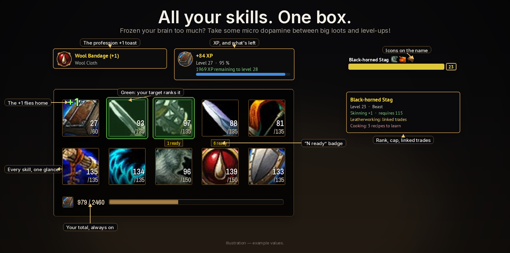

## Every skill. Your total

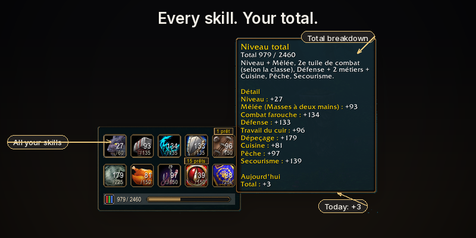

Weapon skills, Defence, professions, level: all in one box, with your total right underneath. No more opening the Skills window just to see what you've earned.

## Know before you swing

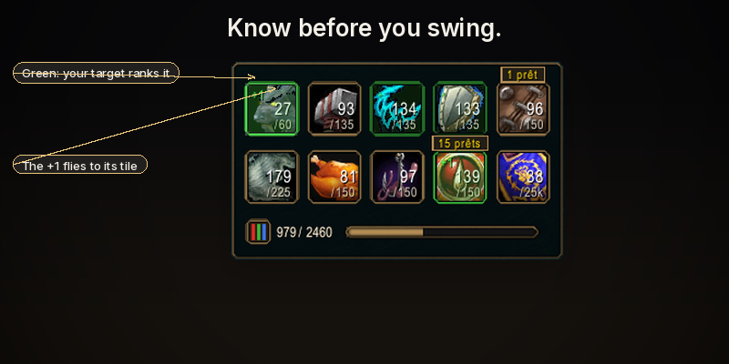

Your target lights up the tiles it will rank in green. You pick the fight, you earn the point. No wasted swings.

## Every profession +1, on top of the panel

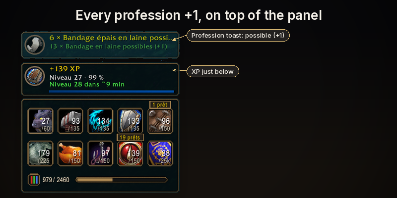

Craft or gather: a toast tells you how many you can make right now — “N × … possibles (+1)” — and the point flies to its tile. You see the point. You earned it.

## The XP, and what's left

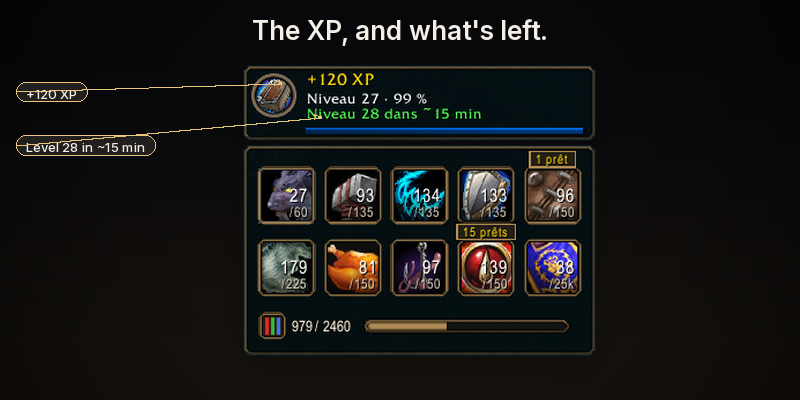

An XP toast tells you how much you just gained, and how long is left before the next level — “+120 XP, Level 28 in ~15 min.” Mid-farm, you always know where you stand.

## Level up

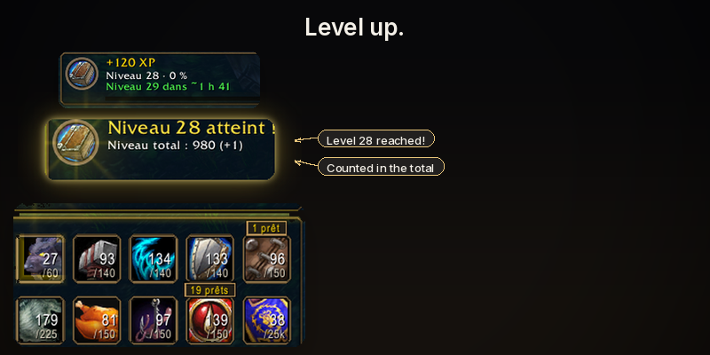

When you ding, a toast celebrates it — “Level 28 reached! Total level: 980 (+1).” Every level, counted in the total.

## Farm on autopilot

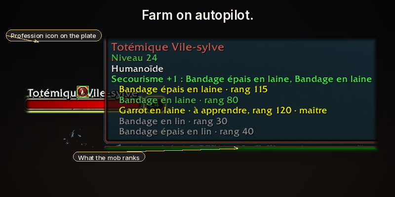

Profession icons sit on the nameplate — “First Aid +1.” Pull the ones that pay. The farm runs itself.

## “N ready” badge

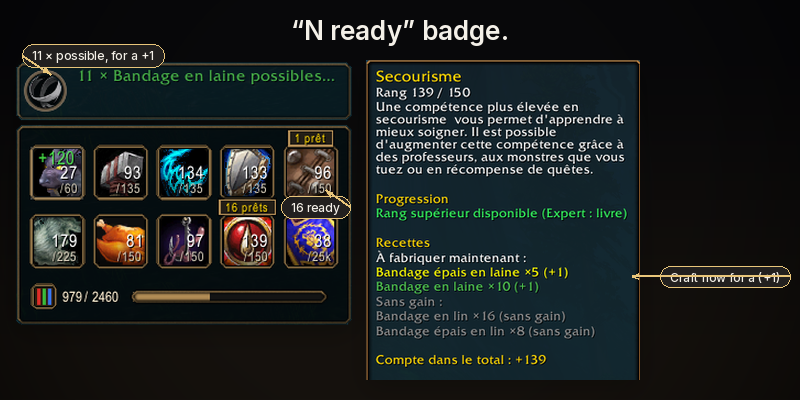

The badge tells you how many recipes you can craft right now to rank the skill — 16 ready, and the tooltip marks “craft now (+1).” You craft, it goes up. That's it.

## Rank, cap, points left

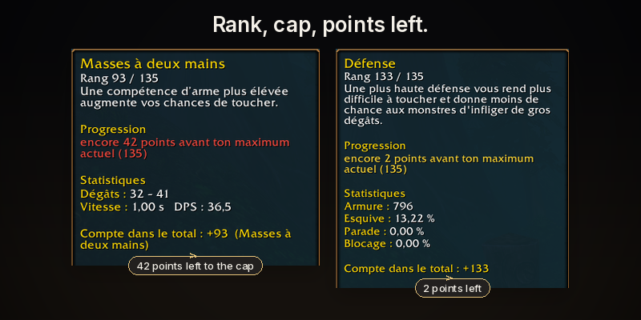

The tooltip shows your rank, your cap, and how many points are left before your current maximum — “42 points left before your cap (135).” You know exactly where you stand.

## PvP, in the box

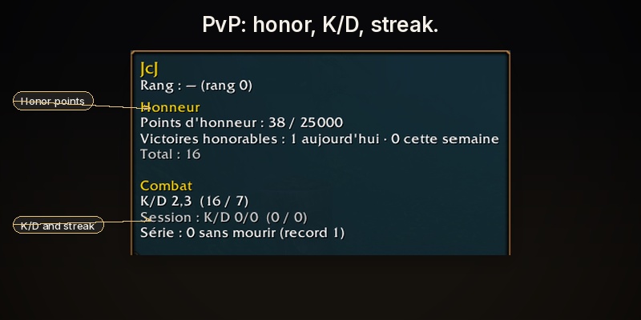

Honor, honorable kills, K/D, streak: the PvP tile keeps your session score, right in the box.

## At rest, the panel fades

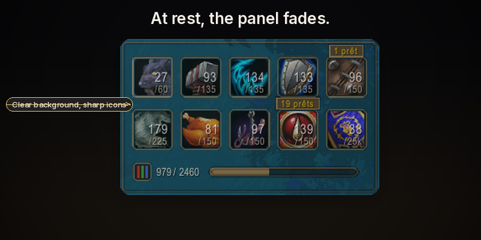

At rest, the panel fades so it never buries your UI. Hover or a gain brings it right back.

## Edit mode

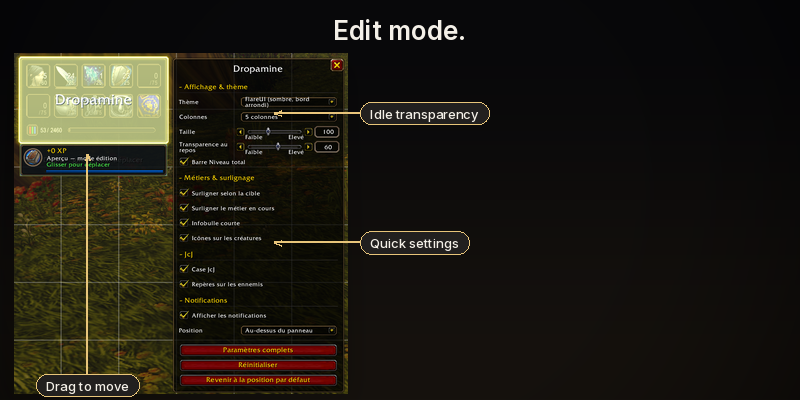

Place the panel on an alignment grid and tune theme, columns, size and rest transparency in seconds.

## Display modes

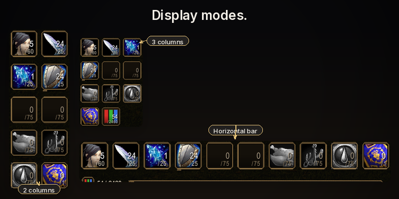

Two columns, three columns, or a horizontal bar with the total progress bar. Fits any UI corner — sidebar or bottom bar.

## Session recap

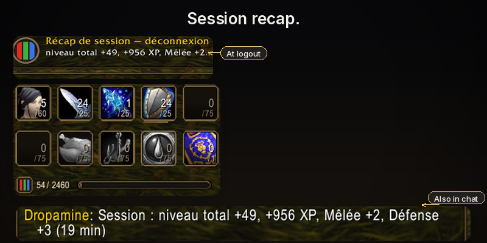

When you log out, a toast tells you exactly what the session earned — total level +49, +956 XP, Melee +2, Defence +3 (19 min) — and the same line is written to chat. Every +1 is counted.

## Dopamine 3.5.0

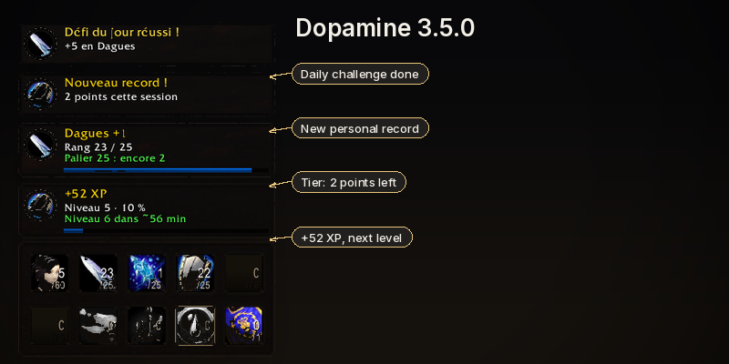

Session combo, daily challenge, your personal records, the next-point bar, the “N discovered” collection, and a celebration when a skill hits its max. Sounds are off by default. It's your grind, and yours alone.

## Three themes

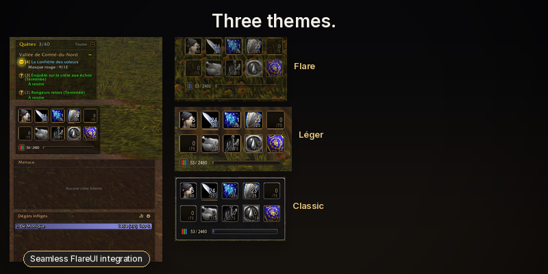

Flare, Léger or Classic: pick the look, keep the same grid. Dropamine also sits seamlessly in a FlareUI layout, next to the quest tracker and the Threat and Damage meters.

`/drop` opens the panel. `/drop debug` is diagnostics.

100% free. WoW Forever only. Dropamine is the perfect companion addon for every session — every mob you kill on the way becomes 100% useful grind, whether you're leveling or PvP roaming. Install it, go farm, and feel every +1 you earned.

---

## Français

Le farm t'a gelé le cerveau ? Prends une dose de micro-dopamine entre deux gros loots et deux level-up !

**Toutes tes compétences. Une seule boîte.**

L'addon parfait à garder ouvert à chaque session : chaque monstre croisé en chemin devient du grind 100 % utile, que tu pexes ou que tu roam en PvP.

Chaque +1, tu l'as gagné. Seul, sans raccourci — juste toi, la grille, et le grind.

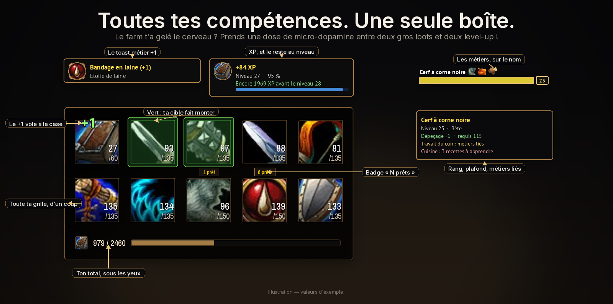

## Toute ta grille, ton total

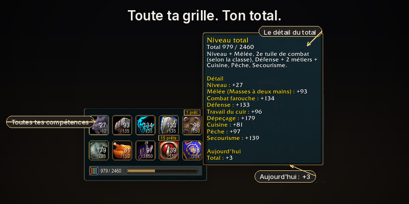

Armes, défense, métiers, niveau : tout dans une seule boîte, avec ton total juste en dessous. Plus besoin d'ouvrir la fenêtre Compétences pour voir ce que tu as gagné.

## Tu sais avant de frapper

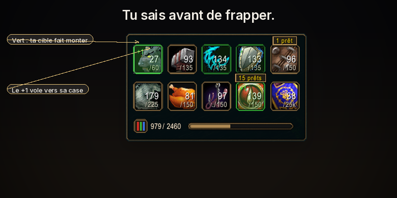

Ta cible allume en vert les cases qu'elle va faire monter. Tu choisis le combat, tu gagnes le point. Pas un coup pour rien.

## Chaque +1 de métier, au-dessus du panneau

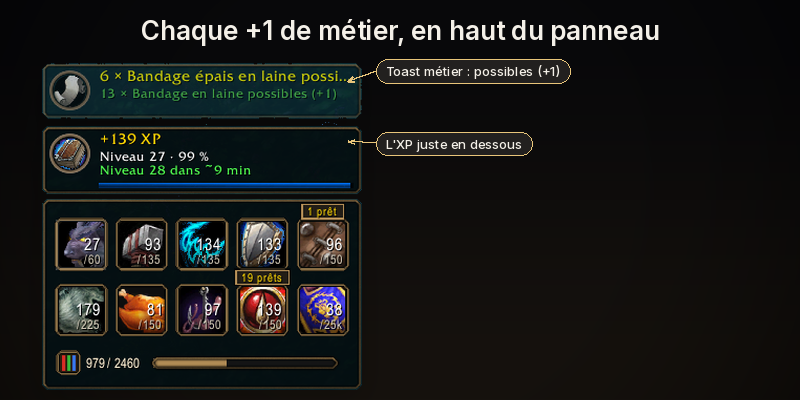

Tu crafts ou tu récoltes : un toast te dit combien tu peux en faire maintenant — « N × … possibles (+1) » — et le point rejoint sa case. Tu vois le point. Tu l'as gagné.

## L'XP, et ce qu'il reste

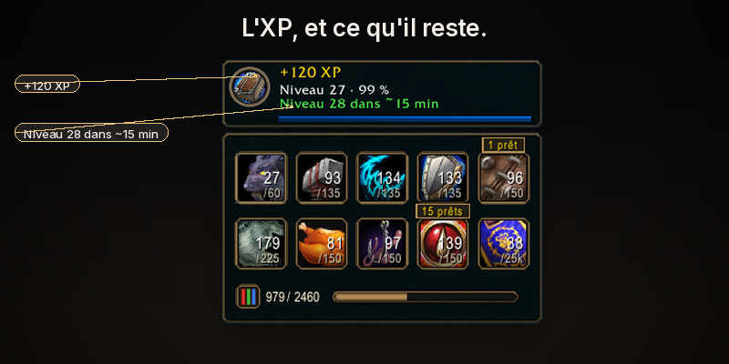

Un toast XP te dit ce que tu viens de gagner, et ce qu'il reste avant le prochain niveau — « +120 XP, Niveau 28 dans ~15 min ». En plein farm, tu sais où tu en es.

## Passage de niveau

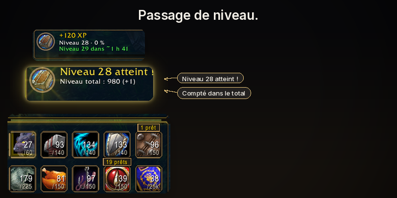

Quand tu ding, un toast le célèbre : « Niveau 28 atteint ! Niveau total : 980 (+1). » Chaque niveau, compté dans le total.

## Le farm en automatique

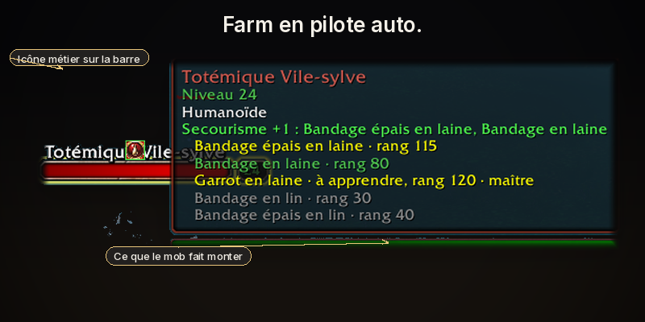

Tes icônes de métier s'affichent sur les barres de nom — « Secourisme +1 ». Tu tires ceux qui paient. Le farm tourne tout seul.

## Le badge « N prêts »

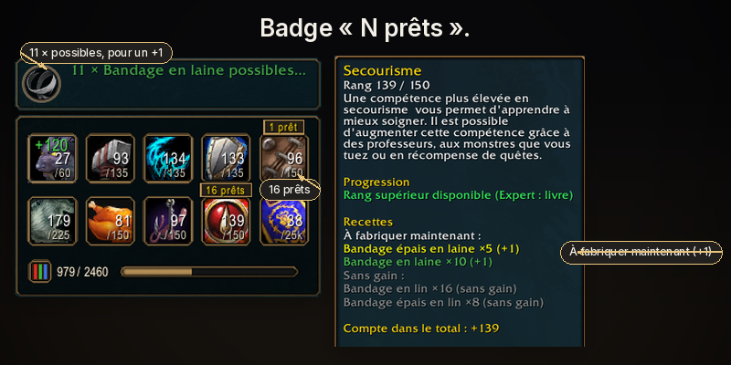

Le badge te dit combien de recettes tu peux crafter maintenant pour faire monter le métier — 16 prêts, et le tooltip le marque « à fabriquer maintenant (+1) ». Tu crafts, ça monte. C'est tout.

## Rang, plafond, encore N points

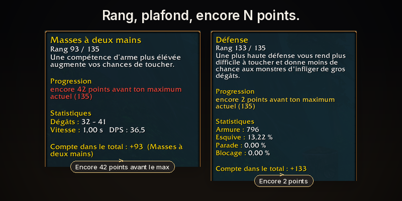

Le tooltip montre ton rang, ton plafond, et combien de points il reste avant ton maximum actuel — « encore 42 points avant ton maximum (135) ». Tu sais exactement où tu en es.

## Le JcJ, dans la boîte

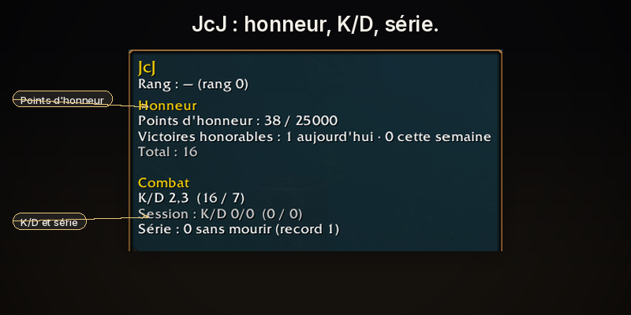

Honneur, victoires honorables, K/D, série : la case JcJ garde le score de ta session, dans la même boîte.

## Au repos, le panneau s'efface

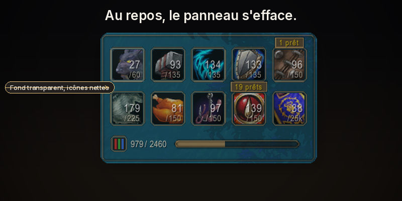

Au repos, le panneau devient transparent pour ne jamais recouvrir ton interface. Un survol ou un gain, et il revient.

## Mode édition

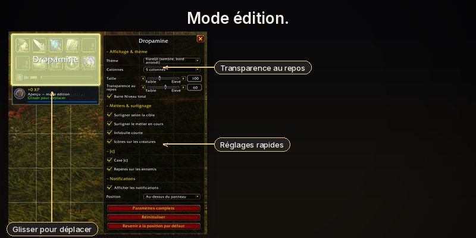

Place le panneau sur une grille d'alignement et règle thème, colonnes, taille et transparence au repos en quelques secondes.

## Modes d'affichage

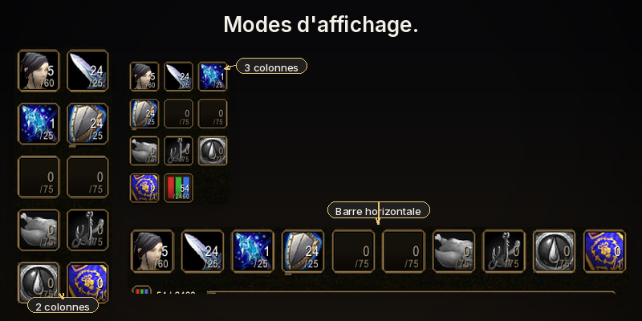

Deux colonnes, trois colonnes, ou une barre horizontale avec la barre de total. Ça se glisse dans n'importe quel coin — en colonne ou en barre du bas.

## Récap de session

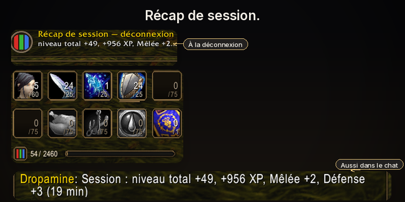

À la déconnexion, un toast te dit exactement ce que la session a rapporté — niveau total +49, +956 XP, Mêlée +2, Défense +3 (19 min) — et la même ligne s'écrit dans le chat. Chaque +1 est compté.

## Dopamine 3.5.0

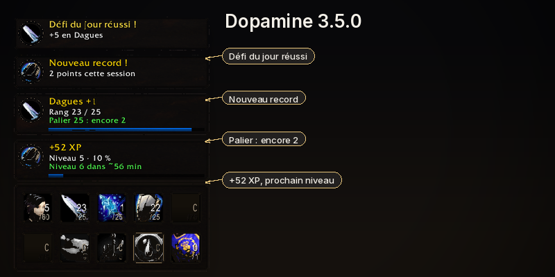

Combo de session, défi du jour, tes records personnels, la barre du prochain point, la collection « N découverts », et une célébration quand une compétence atteint son max. Les sons sont désactivés par défaut. C'est ton grind, et le tien seul.

## Trois thèmes

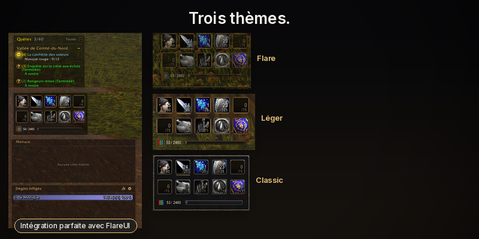

Flare, Léger ou Classic : tu choisis le look, tu gardes la même grille. Dropamine s'intègre aussi parfaitement à FlareUI, entre le suivi de quêtes et les compteurs Menace et Dégâts.

`/drop` ouvre le panneau. `/drop debug` sert au diagnostic.

100 % gratuit. WoW Forever only. L'addon parfait à garder ouvert à chaque session : chaque monstre croisé en chemin devient du grind 100 % utile, que tu pexes ou que tu roam en PvP. Installe-le, va farmer, et ressens chaque +1 que tu as gagné.

## Install

Unzip `Dropamine` into `World of Warcraft\_forever_\Interface\AddOns\`. This addon is for **WoW Forever** only.

## Commands

| Command | What it does |
| --- | --- |
| `/drop` | Show or hide the panel |
| `/dropamine` | Same as `/drop` |

## License

[MIT](LICENSE) — © 2026 Arnaud Martig (Raykuilu). The default look is inspired by FlareUI (Malkkav); no FlareUI files are included. The grid idea comes from Old School RuneScape; no Jagex assets are included.
