# Dropamine

  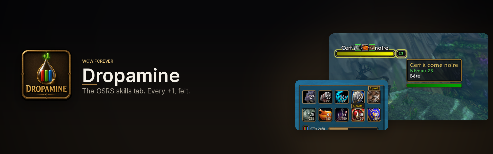

**Every skill-up in one place.** Weapon skills, Defense, Feral Combat, professions, and your level — one panel, so you can see what is about to go up.

WoW Forever only (`## Interface: 16001`). The game’s own Skills tab is left alone.

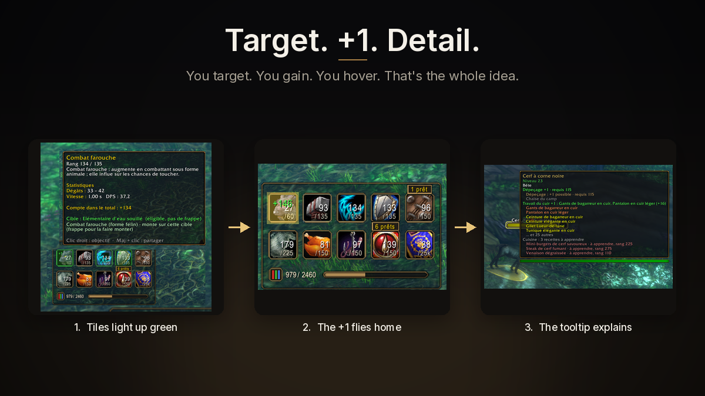

## How it works

1. Type `/drop` (or `/dropamine`). The panel opens. The minimap button does the same.
2. Each tile shows a rank. A green tile can still gain a point on your target — an equipped weapon, Defense, Feral Combat while you are in cat or bear form — or the profession whose window is open, when a recipe is not grey.
3. Every +1 shows up as a toast. In combat, toasts wait until combat ends.

## Live notifications

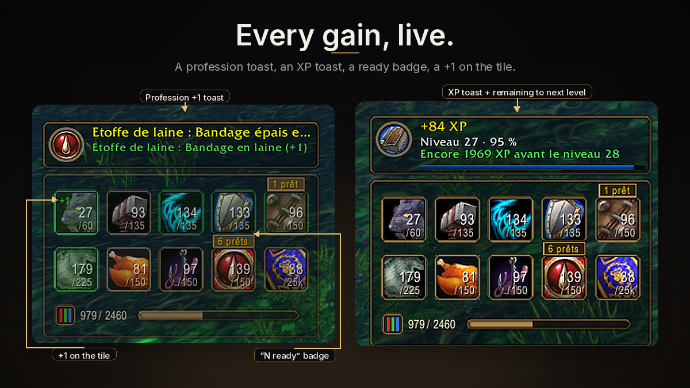

Skill points and experience show above the panel (or below it, or free). A spark can fly from the toast to the tile.

## What lights up

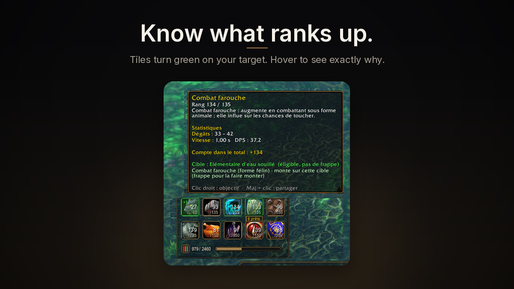

Green means a point is still possible. A softer green means the target qualifies but you are not hitting it yet. Linked professions (cloth and Tailoring, ore and Mining, and so on) get a light veil. Hover a tile to see why.

## The grid

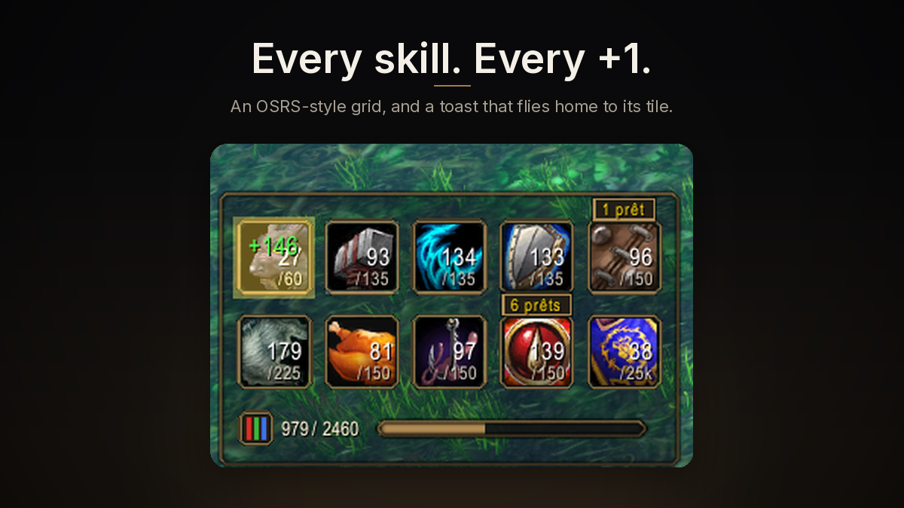

Level, weapon skills, Defense, Feral Combat, and professions. Rank and cap on every tile. Optional total-level bar (`/drop total`).

## Professions

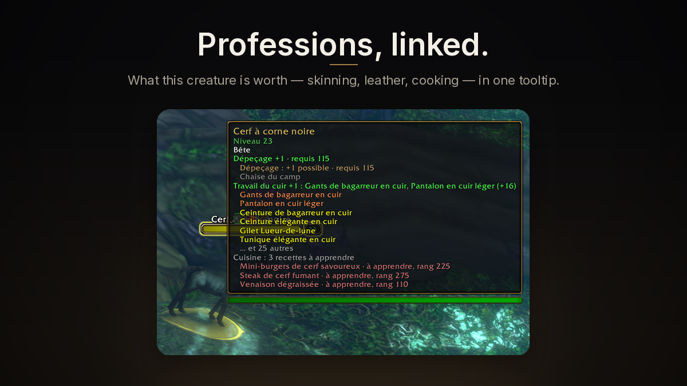

Out of combat, left-click a profession tile to open its window (`/drop ouvrir`). That covers First Aid, Cooking, Tailoring, Leatherworking, Blacksmithing, Engineering, Alchemy, Enchanting, and Mining. Right-click still sets a goal. Shift-click still shares the rank in chat.

## Nameplates

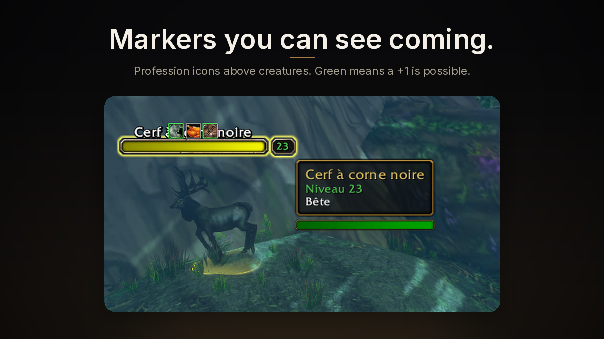

A small profession icon sits above a useful creature: green when a point is possible, grey when it is not. Enemy players use the same green / grey for honour. Markers are placed out of combat and hidden in combat.

## Themes

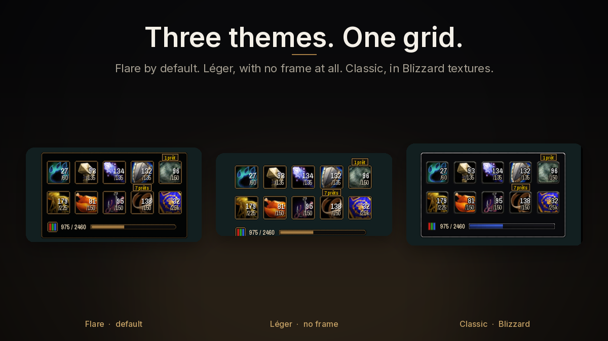

`/drop theme flare|leger|classic`. **Flare** is the default (dark panel, bronze edge). **Léger** is the tiles alone. **Classic** uses Blizzard textures only.

## In game

| | | |
| :---: | :---: | :---: |
| 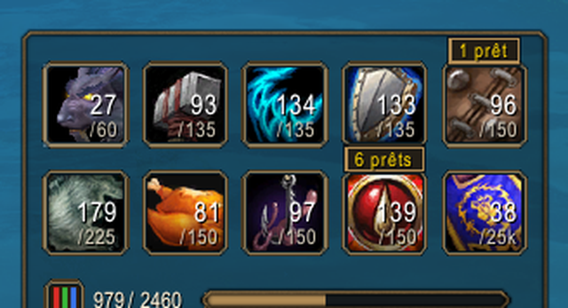 | 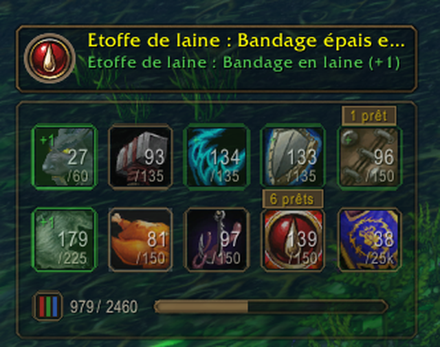 | 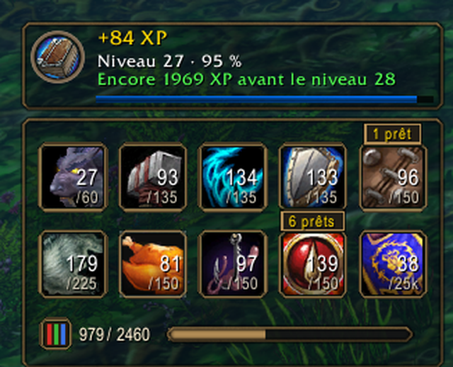 |
| 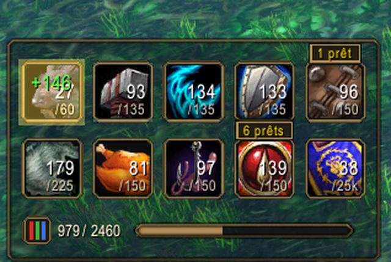 | 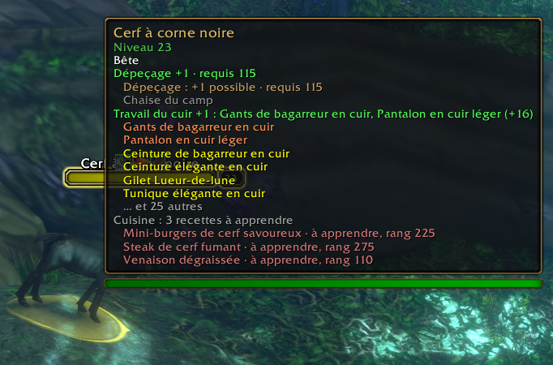 | 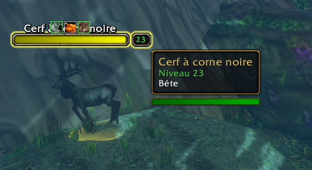 |

## Commands

| Command | What it does |
| --- | --- |
| `/drop` | Show or hide the panel |
| `/dropamine` | Same as `/drop` |
| `/drop ouvrir` | Left-click a profession tile to open its window (out of combat) |
| `/drop debug` | Copyable diagnostic window |
| `/drop debug metier` | Same window, profession section only |
| `/drop perf` | What the addon has been doing since login (events, scans, time) |

`/drop help` prints the short list. `/drop help tout` prints every command.

## Install

Unzip `Dropamine` into `World of Warcraft\_forever_\Interface\AddOns\`. This addon is for **WoW Forever** only.

## License

[MIT](LICENSE) — © 2026 Raykuilu. The default look is inspired by FlareUI (Malkkav); no FlareUI files are included. The grid idea comes from Old School RuneScape; no Jagex assets are included.
