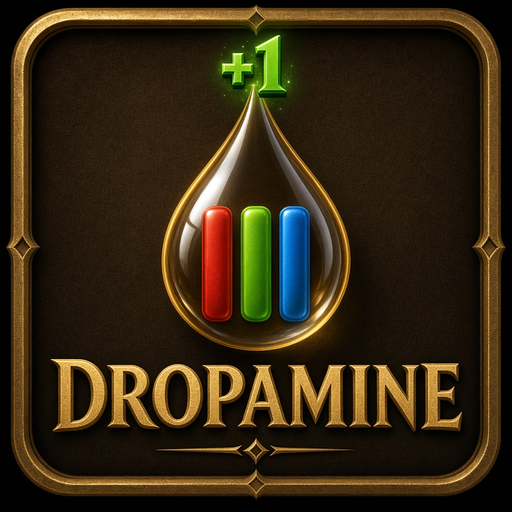
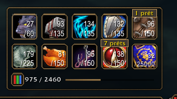
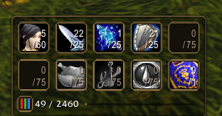
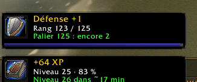
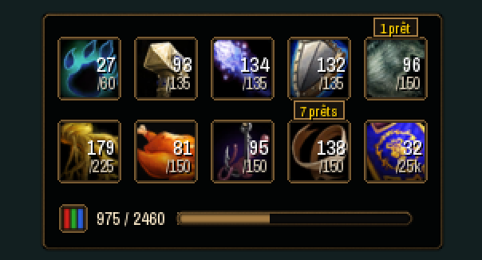
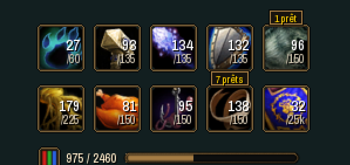
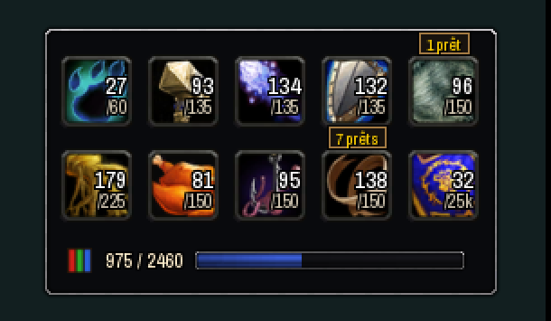

# Dropamine

  

**The OSRS skills tab, in WoW Forever.** One compact grid for every skill, the little rush of each **+1** drop, and a clear answer to “what ranks up on this target?” — built for long farming sessions.

Formerly *OSRS Total Level*. Game: **WoW Forever** (`## Interface: 16001`). The native Skills tab is never hidden, moved, or rewritten.

[Features](#features) · [Themes](#themes) · [Install](#install) · [Slash commands](#slash-commands) · [Credits](#credits) · [Français](#français)

## Screenshots

Theme previews (QC renders, not in-game captures):

| Flare (default) | Léger | Classic |
| :---: | :---: | :---: |
|  |  |  |

## Features

Every item below is implemented in the 3.4.0 source; nothing is planned or hoped-for.

**Tiles & levels**
- OSRS-style icon grid: level, weapon skills, Feral Combat, Defence, professions, secondary skills (stats optional: `/drop stats on`).
- Rank / max on every tile, coloured by tier (red, yellow, green) or a fixed colour.
- Optional “Total level / 2460” bar under the tiles.
- “N ready” badge: how many recipes your bags can craft for a +1.
- Goals: right-click a tile (Shift + right-click = next tier), `/drop objectif`.
- Shift-click a tile to paste “Skinning 161/225” into chat.
- 1, 2, 3, 5 or 10 columns; 50–200 % scale.

**Highlights (target, weapons, feral, Defence)**
- Tiles that can rank up on your target turn green: XP (non-grey target), weapons you actually have equipped, Defence, Cooking / First Aid (loot used by a known recipe), Skinning (skinnable beast that still gives points).
- Two levels: strong green while you are really hitting (or being hit, for Defence), soft green when the target merely qualifies.
- Druids: in cat / bear form only Feral Combat and Defence light up; in caster form, your weapon.
- Estimated 5 × target-level cap and “no Defence on grey targets”, explained on hover.
- Indirect links (light veil): cloth → Tailoring, leather → Leatherworking, etc.
- New in 3.4.0: **profession in progress** in strong green (fishing, cooking, first aid, any craft, herbing, mining, skinning); fishing pole equipped or profession window open = soft green.

**Professions & links**
- New in 3.4.0: with a profession window open, related professions light up softly (First Aid ← Tailoring, Cooking ← Fishing, Leatherworking ← Skinning, Blacksmithing / Engineering ← Mining, Alchemy ← Herbalism…), details on hover.
- “Used by” in item tooltips: every recipe that uses it, learned or not, with required rank and difficulty colour.
- Recipes still to learn (required rank, trainer when known).
- Clickable “N × recipe possible” toasts open the profession window on the right recipe (out of combat, otherwise queued).
- Shopping list of reagents for your goals (`/drop courses`).
- Fishing catches per zone; skinning alerts; optional restyle of the Professions window.

**Nameplate markers**
- Small profession icon above useful creatures: green = +1 possible, grey = nothing to gain.
- Pelt marker on skinnable beasts.
- PvP: markers on enemy players (green = honour, grey = none).
- Placed out of combat, hidden in combat.

**Tooltips**
- Creature: one line per profession (3 max), hold Shift for details.
- Tile: rank, today's gains, 7-day history, time estimate (“125 in ~40 min”), alts, why it is green.
- Minimap button tooltip: “Total level: X / 2460”, then “Click: open / close”.

**Toasts & recap**
- Skill +1 and XP toasts, above / below the panel or anywhere; full or one-line format; adjustable duration.
- A spark flies from the toast to the tile, then a green “+N”.
- Level-up animation (optional sound), tier reached, goal reached, personal milestones, reminder 5 points before the tier cap.
- Quiet reminders: under-levelled weapon, weapon master (unlearned weapon), main weapon to re-equip, Defence vs grey mobs.
- Session recap at the start of the logout countdown (toast + chat line), `/drop recap` any time.
- In combat, toasts wait until combat ends.

**PvP**
- PvP tile: rank, honour, honourable kills.
- “+1 honourable kill” toasts, death-free streak, K/D, daily goal.

**Themes**
- FlareUI (default): dark fill, rounded bronze border (original artwork).
- Léger: just the tiles, no frame or background (new in 3.4.0: no frame at all).
- Classic: Blizzard textures (tooltip border, action-button frames, status bar).

**Minimap button & Edit Mode**
- Minimap button (three-pillar icon, same bevelled frame as the total bar): click to open / close the panel; tooltip “Total level: X / 2460 · Click: open / close”. Works docked in a minimap button tray. `/drop minimap` shows or hides it.
- Hover and pressed states drawn exactly on the button's plate (3.4.1).
- Game Edit Mode: overlay on the panel + quick-settings window; position kept.
- Drag the panel from anywhere, resize grip (Alt-drag = columns), lock, idle transparency and damage-meter-style fade.

**Commands & settings**
- `/drop` or `/dropamine`; `/drop help` (short, grouped) and `/drop help tout` (everything).
- Settings in 5 groups (Display & theme, Professions & highlights, PvP, Notifications, Advanced), one help line per setting, “Defaults” button.
- Settings imported automatically from OSRS Total Level.

**Performance**
- Fully event-driven; while idle nothing runs (no polling, no animation).
- Cached results (target, links, tooltips), pooled frames.
- No secure-frame changes, no Blizzard frame modified (safe hooks only); `/drop perf` and `/drop debug` to check.

Options: Interface → AddOns, or `/drop options`. Coming from *OSRS Total Level*: settings are copied once from `OSRS_TotalLevelDB` into `DropamineDB` (the old table is never modified); remove `AddOns/OSRS_TotalLevel` after the first login.

## Themes

Switch with `/drop theme flare|leger|classic`, in the options, or in Edit Mode. Default is **Flare**.

| Id | Label | What you get |
| --- | --- | --- |
| `flare` | Flare (default) | Dark dialog background, rounded bronze border (`#A67D45`). Visual style inspired by FlareUI by Malkkav; the border, thin rule and bar track are Dropamine’s own textures, not FlareUI files. |
| `leger` | Léger | Just the tiles: no frame, no background (3.4.0). Handles appear on hover. |
| `classic` | Classic | Only in-game Blizzard textures, referenced by path: tooltip border, action-button frames (`UI-Quickslot2`), and a status-bar total (`UI-StatusBar`). Nothing is copied into `Media/`. |

## Install

1. Download the latest `Dropamine-x.y.z.zip` from GitHub Releases or CurseForge.
2. Unzip it into `World of Warcraft\_forever_\Interface\AddOns\`, so you have `AddOns\Dropamine\Dropamine.toc`.
3. The toc declares `## Interface: 16001` (Forever 1.60.1). If the game marks it out of date after a patch, enable “Load out of date addons”.

This addon is written for **WoW Forever**. It is not tested on official Retail, MoP Classic, or Classic Era.

## Slash commands

The only commands are **`/drop`** and **`/dropamine`** (they are the same handler). Type `/drop` with no argument to show or hide the panel.

| Command | Purpose |
| --- | --- |
| `/drop` | Toggle the panel (also: minimap button, click a toast) |
| `/drop options` | Open the options panel |
| `/drop theme flare\|leger\|classic` | Switch theme |
| `/drop reset` | Restore the default panel position |
| `/drop verrou on\|off` | Lock or unlock the panel |
| `/drop taille 50-200` | Scale (%) |
| `/drop colonnes 1\|2\|3\|5\|10` | Layout (or drag the bottom-right handle; Alt-drag changes columns) |
| `/drop opacite 0-100` | Idle background opacity |
| `/drop fondu <seconds>` | Fade delay |
| `/drop notif dessus\|dessous\|detache` | Toast anchor |
| `/drop drops on\|off\|move` | Skill and XP toasts |
| `/drop recap` | Print the session recap now |
| `/drop recap on\|off` | Recap toast at the start of the logout countdown |
| `/drop pvp on\|off` | PvP module |
| `/drop scanner on\|off` | Icons above useful creatures |
| `/drop alertes on\|off` | Target highlights, gathering alerts and nameplate markers |
| `/drop activite on\|off` | Highlight the profession in progress (fishing, crafting) and linked professions |
| `/drop help` / `/drop help tout` | Short grouped help / every command |
| `/drop edit` | Edit-mode overlay and quick settings |
| `/drop minimap` | Show or hide the minimap button |

Further toggles (all `on\|off` unless noted): `/drop eta`, `prepalier`, `historique`, `alts`, `jalons`, `peche`, `defense`, `partage`, `maitre`, `session`, `rappel`, `liens`, `nonapprises`, `recettes`, `total`, `anim`, `son`, `style`, `categories`, `statistiques` / `stats`, `paliers`, plus `/drop objectif`, `/drop couleurs`, `/drop arme`, `/drop courses`, `/drop infobulle compacte|detail`, `/drop options defaut`. `/drop help` prints a short grouped list; `/drop help tout` prints everything.

## Settings

The options panel (Interface → AddOns or `/drop options`) has five groups. Labels are in French (the addon is French-only for now).

**Affichage & thème** — L'apparence du panneau : thème, disposition, taille.

| Réglage | Défaut | Commande | Aide |
| --- | --- | --- | --- |
| Thème | FlareUI (sombre, bord arrondi) | `/drop theme flare\|leger\|classic` | Change l'habillage du panneau, des cases et des toasts. |
| Colonnes | 5 colonnes | `/drop colonnes 1\|2\|3\|5\|10` | Nombre de cases par rangée (aussi : poignée du coin, Alt+glisser). |
| Taille | 100 % | `/drop taille <50-200>` | Taille du panneau ; les cases restent nettes. |
| Transparence au repos | 60 % | `/drop opacite <0-100>` | Visibilité du panneau quand rien ne se passe. |
| Couleur des chiffres | Selon le palier | `/drop couleurs palier\|vert\|jaune` | Selon le palier : rouge, puis jaune, puis vert près du maximum. |
| Barre Niveau total | non | `/drop total on\|off` | Ajoute une barre fine « total / 2460 » sous les cases. |
| Verrouiller | non | `/drop verrou on\|off` | Empêche de déplacer le panneau et le bouton par erreur. |

**Métiers & surlignage** — Les cases qui s'allument en vert, et les liens entre métiers.

| Réglage | Défaut | Commande | Aide |
| --- | --- | --- | --- |
| Surligner selon la cible | oui | `/drop alertes on\|off` | Vert sur les cases que ta cible peut faire monter. |
| Surligner le métier en cours | oui | `/drop activite on\|off` | Vert en pêchant / fabriquant ; liens discrets quand une fenêtre de métier est ouverte. |
| Pastille « N prêts » | oui | `/drop recettes on\|off` | Nombre de recettes que tes sacs permettent de faire pour un +1. |
| Liens entre métiers | oui | `/drop liens on\|off` | « Utilisé par » dans l'infobulle des objets et des créatures. |
| Recettes à apprendre | oui | `/drop nonapprises on\|off` | Montre aussi les recettes pas encore apprises (rang requis). |
| Icônes sur les créatures | oui | `/drop scanner icones on\|off` | Petite icône de métier au-dessus du nom : vert = +1 possible. |
| Infobulle courte | oui | `/drop infobulle compacte\|detail` | Une ligne par métier ; maintiens Maj pour le détail. |
| Habiller la fenêtre Métiers | oui | `/drop style on\|off` | Barres et encadrés au style de Dropamine dans la fenêtre du jeu. |
| Prises de pêche par zone | oui | `/drop peche on\|off` | Retient ce que tu pêches dans chaque zone. |
| Liste de courses (objectifs) | oui | `/drop courses on\|off` | Composants à réunir pour tes objectifs de métier. |

**JcJ** — Honneur, victoires honorables et repères sur les ennemis.

| Réglage | Défaut | Commande | Aide |
| --- | --- | --- | --- |
| Case JcJ | oui | `/drop pvp on\|off` | Rang, honneur et série de victoires dans la grille. |
| Repères sur les ennemis | oui | `/drop pvp marques on\|off` | Vert : rapporte de l'honneur ; gris : ne rapporte rien. |

**Notifications** — Les petits messages quand tu gagnes quelque chose.

| Réglage | Défaut | Commande | Aide |
| --- | --- | --- | --- |
| Afficher les notifications | oui | `/drop drops on\|off` | Interrupteur général des toasts de gain. |
| Position | Au-dessus du panneau | `/drop notif dessus\|dessous\|detache` | Où apparaissent les toasts. |
| Format | Complet | `/drop drops style complet\|leger` | Toast complet ou une seule ligne discrète. |
| Gains d'XP | oui | `/drop drops xp on\|off` | Toast à chaque gain d'expérience. |
| Gains de compétence | oui | `/drop drops comp on\|off` | Toast à chaque +1 de compétence. |
| Animation vers la case | oui | `/drop animation on\|off` | Un éclat vole du toast jusqu'à la case, puis « +N ». |
| Palier atteint | oui | `/drop paliers on\|off` | Prévient quand il faut aller voir ton maître. |
| Objectif atteint | oui | `/drop objectif on\|off` | Prévient quand un objectif (clic droit sur une case) est atteint. |
| Animation de niveau | oui | `/drop anim on\|off` | Grande animation à chaque niveau. |
| Son de niveau | non | `/drop anim son on\|off` | Joue un son avec l'animation de niveau. |
| Durée d'affichage | 2.6 s | `/drop drops duree <1-10>` | Temps pendant lequel un toast reste visible. |
| Rappel avant le palier | oui | `/drop prepalier on\|off` | Prévient 5 points avant le maximum du palier. |
| Jalons personnels | oui | `/drop jalons on\|off` | Fête tes caps : premier 150, total 1000… |
| Récap à la déconnexion | oui | `/drop recap on\|off` | Résumé de la session au moment de te déconnecter. |

**Avancé** — Réglages fins et rappels secondaires. Les valeurs par défaut conviennent à tous.

| Réglage | Défaut | Commande | Aide |
| --- | --- | --- | --- |
| Fond au survol | 45 % | `/drop fond <0-100>` | Opacité du fond quand le panneau est actif. |
| Délai avant repos | 3 s | `/drop fondu <0-60>` | Secondes avant que le panneau redevienne discret. |
| Fond des toasts | 68 % | `/drop drops opacite <0-100>` | Opacité du fond des toasts (Classique / repli). |
| Apprendre le butin | oui | `/drop scanner on\|off` | Mémorise ce que lâchent les créatures (à laisser activé). |
| Toast « recette possible » | non | `/drop scanner toast on\|off` | Toast quand une créature proche donne un ingrédient utile. |
| Son du toast recette | non | `/drop scanner son on\|off` | Petit son avec le toast « recette possible ». |
| Gains du jour | oui | `/drop session on\|off` | « +N aujourd'hui » dans l'infobulle des cases. |
| Rappel arme en retard | oui | `/drop rappel on\|off` | Signale discrètement une arme en main sous-montée. |
| Temps estimé jusqu'au rang | oui | `/drop eta on\|off` | « 125 dans ~40 min » d'après ton rythme mesuré. |
| Historique 7 jours | oui | `/drop historique on\|off` | Gains des 7 derniers jours dans l'infobulle des cases. |
| Autres personnages | oui | `/drop alts on\|off` | Compare tes rangs avec tes autres personnages. |
| Rappel Défense (ennemis gris) | oui | `/drop defense on\|off` | Rappelle que la Défense ne monte pas sur les ennemis gris. |
| Maj+clic : partager dans le chat | oui | `/drop partage on\|off` | Maj+clic sur une case : « Dépeçage 161/225 » dans le chat. |
| Rappel maître d'armes | oui | `/drop maitre on\|off` | Signale une arme équipée que tu n'as pas apprise. |
| Rappel arme principale | oui | `/drop arme on\|off` | Rappelle de remettre ton arme principale (hors combat). |

## Credits

- **Author:** Arnaud Martig (Raykuilu)
- **Visual style** of the default theme is *inspired by* FlareUI by **Malkkav**. Dropamine does not depend on FlareUI, does not include FlareUI code, and (as of 3.3.17) does not ship FlareUI image files. The panel border (`Media/Dropamine-Frame.tga`), the bar rule and the bar track are original drawings. The bronze `#A67D45` is a colour, not a copyrighted work.
- Skill-grid *idea* inspired by the Old School RuneScape skills tab. No Jagex assets are included.
- World of Warcraft and all Blizzard textures referenced by path are © Blizzard Entertainment.

## License

[MIT](LICENSE) — © 2026 Arnaud Martig (Raykuilu)

---

## Français

**Dropamine**, c’est le skills tab façon OSRS, dans WoW Forever : tes compétences d’un coup d’œil, le petit shot de dopamine à chaque **+1**, et ce qui monte vraiment sur ta cible. Pensé pour les sessions de farm un peu longues.

Anciennement *OSRS Total Level*. Client : **WoW Forever** (`Interface: 16001`). L’onglet Comp. natif n’est jamais touché.

### Toutes les fonctions

**Cases & niveaux**
- Grille d'icônes façon OSRS : niveau, compétences d'armes, Combat farouche, Défense, métiers, compétences secondaires (et caractéristiques en option : `/drop stats on`).
- Rang / max sur chaque case, couleur selon le palier (rouge, jaune, vert) ou fixe (vert / jaune).
- Barre « Niveau total / 2460 » (option) sous les cases.
- Pastille « N prêts » : nombre de recettes que tes sacs permettent de faire pour un +1.
- Objectifs : clic droit sur une case (Maj + clic droit = palier suivant), `/drop objectif`.
- Maj + clic sur une case : « Dépeçage 161/225 » collé dans le chat.
- 1, 2, 3, 5 ou 10 colonnes ; taille 50–200 %.

**Surlignage (cible, armes, farouche, Défense)**
- Selon ta cible, les cases qui peuvent monter s'allument en vert : XP (cible pas grise), armes réellement équipées, Défense, Cuisine / Secourisme (butin utile à une recette connue), Dépeçage (bête dépeçable qui rapporte encore).
- Deux niveaux : vert fort quand tu frappes vraiment (ou que la cible te frappe, pour la Défense), vert discret si la cible convient seulement.
- Druide : en félin / ours, seuls Combat farouche et Défense s'allument ; en forme humanoïde, l'arme.
- Plafond estimé 5 × niveau de la cible, et Défense sans gain sur cible grise, expliqués au survol.
- Liens indirects (voile léger) : tissu → Couture, cuir → Travail du cuir, etc.
- Nouveau 3.4.0 : **métier en cours** en vert fort (pêche, cuisine, secourisme, toute fabrication, cueillette, minage, dépeçage) ; canne à pêche équipée ou fenêtre du métier ouverte = vert discret.

**Métiers & liens**
- Nouveau 3.4.0 : fenêtre de métier ouverte → les métiers liés s'allument discrètement (Secourisme ← Couture, Cuisine ← Pêche, Travail du cuir ← Dépeçage, Forge / Ingénierie ← Minage, Alchimie ← Herboristerie…), détail au survol.
- « Utilisé par » dans l'infobulle des objets : toutes les recettes qui l'utilisent, apprises ou non, avec rang requis et couleur de difficulté.
- Recettes à apprendre (rang requis, maître quand on le sait).
- Toasts « N × recette possibles » cliquables : ouvrent la fenêtre du métier sur la bonne recette (hors combat, sinon mise en attente).
- Liste de courses des composants pour tes objectifs (`/drop courses`).
- Prises de pêche par zone ; alertes de dépeçage ; habillage optionnel de la fenêtre Métiers.

**Repères sur les barres de nom**
- Petite icône de métier au-dessus des créatures utiles : verte = +1 possible, grise = rien à gagner.
- Repère de peau sur les bêtes dépeçables.
- JcJ : repères sur les joueurs ennemis (vert = honneur, gris = rien).
- Posés hors combat, cachés en combat.

**Infobulles**
- Créature : une ligne par métier (3 au plus), Maj pour le détail.
- Case : rang, gains du jour, historique 7 jours, temps estimé (« 125 dans ~40 min »), autres personnages, pourquoi elle est verte.
- Infobulle du bouton de minicarte : « Niveau total : X / 2460 », puis « Clic : ouvrir / fermer ».

**Toasts & récap**
- Toasts +1 de compétence et gains d'XP, au-dessus / en dessous du panneau ou à une place libre ; format complet ou une ligne ; durée réglable.
- Éclat qui vole du toast jusqu'à la case, puis « +N » vert.
- Animation de montée de niveau (son en option), palier atteint, objectif atteint, jalons personnels, rappel 5 points avant le palier.
- Rappels discrets : arme sous-montée, maître d'armes (arme non apprise), arme principale à remettre, Défense contre ennemis gris.
- Récap de session au début du compte à rebours de déconnexion (toast + ligne de chat), `/drop recap` à tout moment.
- En combat, les toasts attendent la fin du combat.

**JcJ**
- Case JcJ : rang, honneur, victoires honorables.
- Toasts « +1 victoire honorable », série sans mourir, K/D, objectif du jour.

**Thèmes**
- FlareUI (défaut) : fond sombre, bord bronze arrondi (dessin original).
- Léger : seulement les cases, sans cadre ni fond (nouveau 3.4.0 : plus aucun cadre autour).
- Classique : textures Blizzard (bord d'infobulle, cadres de boutons d'action, barre d'état).

**Bouton de minicarte & mode édition**
- Bouton de minicarte (icône 3 piliers, même cadre biseauté que la barre total) : clic = ouvrir / fermer le panneau ; infobulle « Niveau total : X / 2460 · Clic : ouvrir / fermer ». Fonctionne rangé dans un tiroir de boutons de minicarte. `/drop minimap` l'affiche ou le cache.
- Survol et appui dessinés exactement sur la plaque du bouton (3.4.1).
- Mode édition du jeu : calque sur le panneau + fenêtre de réglages rapides ; position gardée.
- Panneau déplaçable de partout, poignée de redimensionnement (Alt + glisser = colonnes), verrou, transparence au repos et fondu façon compteur de dégâts.

**Commandes & réglages**
- `/drop` ou `/dropamine` ; `/drop help` (court, rangé) et `/drop help tout`.
- Réglages en 5 groupes (Affichage & thème, Métiers & surlignage, JcJ, Notifications, Avancé), une phrase d'aide par réglage, bouton « Valeurs par défaut ».
- Réglages repris automatiquement depuis OSRS Total Level.

**Performance**
- Tout est piloté par les événements ; au repos, rien ne tourne (aucune lecture périodique, aucune animation).
- Calculs mis en cache (cible, liens, infobulles), cadres réutilisés.
- Rien sur les cadres sécurisés, aucun cadre Blizzard modifié (crochets sûrs seulement) ; `/drop perf` et `/drop debug` pour vérifier.

### Installation

Dézippe `Dropamine-x.y.z.zip` dans `World of Warcraft\_forever_\Interface\AddOns\`. Si tu venais d’OSRS Total Level : laisse l’ancien dossier coché pour la **première** connexion (tes réglages sont copiés une fois, un message le confirme dans le chat), puis supprime `AddOns\OSRS_TotalLevel` et fais `/reload`.

### Commandes

Uniquement **`/drop`** et **`/dropamine`**. `/drop` tout seul ouvre ou ferme le panneau. `/drop options`, `/drop theme flare|leger|classic`, `/drop recap`, `/drop verrou`, `/drop taille`, `/drop colonnes` couvrent l’usage de tous les jours. `/drop help` donne l’aide courte rangée, `/drop help tout` toutes les commandes ; la liste des réglages est dans la section *Settings* plus haut.

### Crédits et licence

Style du thème par défaut inspiré de **FlareUI** (Malkkav) : aucun fichier image de FlareUI n’est livré, le bord est le nôtre. Licence **MIT**, auteur Arnaud Martig (Raykuilu).
