# Dropamine

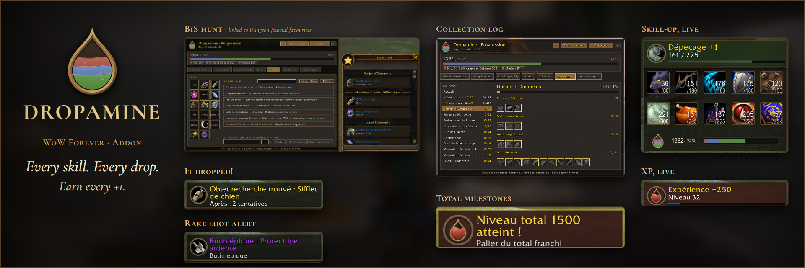

&nbsp;

*[Version française plus bas](#français)*

**Dropamine 3.8** puts every skill on screen, celebrates each +1 like Old School RuneScape, and now tracks the gear you are farming: a **Collection log** for every dungeon and raid, and a **BiS hunt** that reads your **Dungeon Journal favourites**.

For **WoW Forever** only (`Interface: 16001`). The native Skills tab is never hidden, moved or rewritten. FlareUI is not required.

## New in 3.8: Collection log

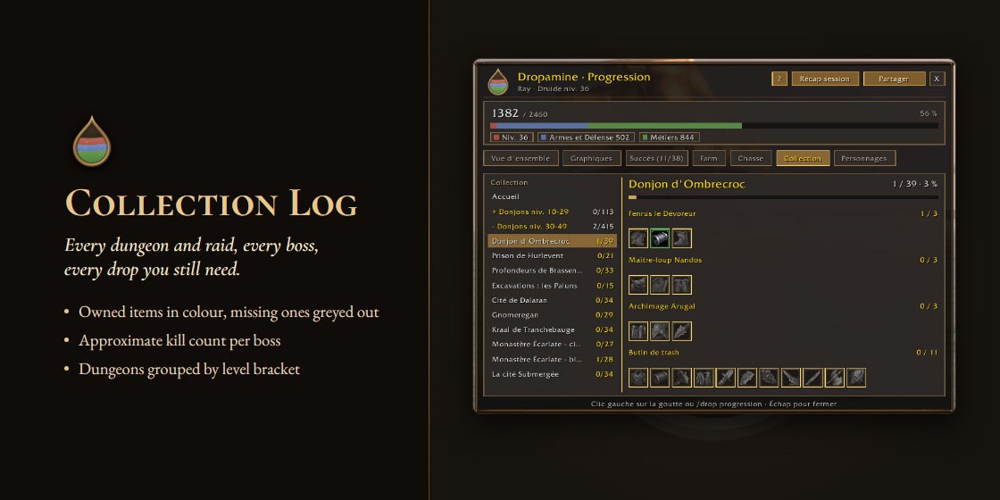

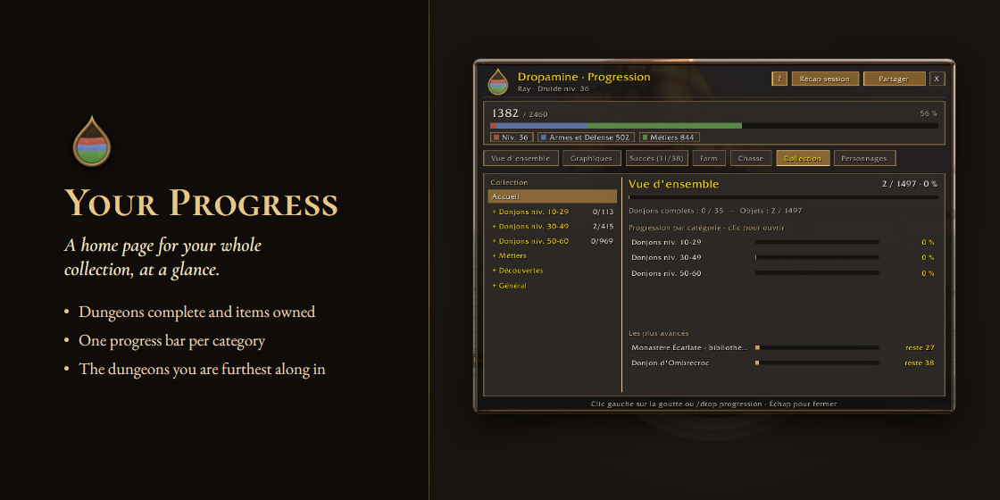

Your Old School RuneScape-style collection log, for WoW Forever dungeons and raids.

- **Every dungeon and raid**, grouped by level bracket. Each boss shows its items with their icons: the ones you own in colour, the missing ones greyed out.
- **Approximate kill count per boss** (≈N kills), counted from the loot of its tracked items.
- **A Home page** opens first: overall progress, dungeons completed, boss kills, items, one progress bar per category (click to open it), and the dungeons you are furthest along in.
- **Professions too:** known recipes out of the total for every profession you have learned. For Cooking and First Aid, the missing recipes are listed by required skill and source.
- **Discoveries:** the bestiary and skinnable creatures you have met, by 10-level bracket, with your own bracket highlighted.
- Categories fold and unfold, and each one shows its own X / Y. Item, dungeon and boss names follow your game language.

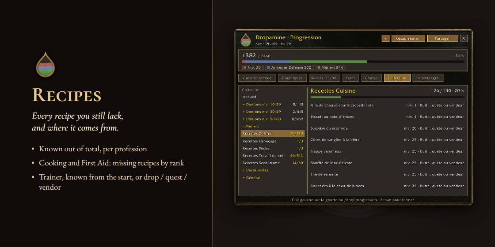

`/drop collection` · Collection achievements: Collector (10 %), Great collector (25 %), Dream collection (50 %).

## New in 3.8: BiS hunt, linked to Dungeon Journal favourites

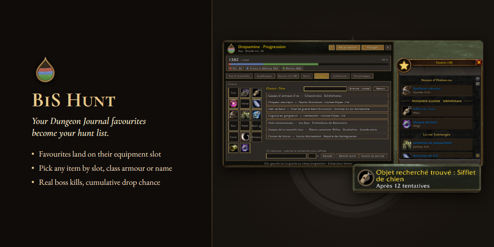

Pick the item you want, then go get it.

- **Your Dungeon Journal favourites become your hunt list.** Every item you starred is placed on its equipment slot automatically. When several items compete for the same slot, the best one is shown on the grid.
- **An equipment grid.** Click a slot to choose the item from the Dungeon Journal data (filter by your class's armour, search by name). You can also add an item by name, link or ID, or from your last loot.
- **Real attempts.** Boss kills are detected from loot messages, so an attempt is a real kill, not an opened loot window. For each item: attempts, and the cumulative chance it should have dropped by now.
- **It dropped!** A toast with the item icon. Click it to open the item card, with the equipment comparison.
- **Rare loot alert:** a toast in the item's quality colour for every epic (or rare, if you choose) drop.
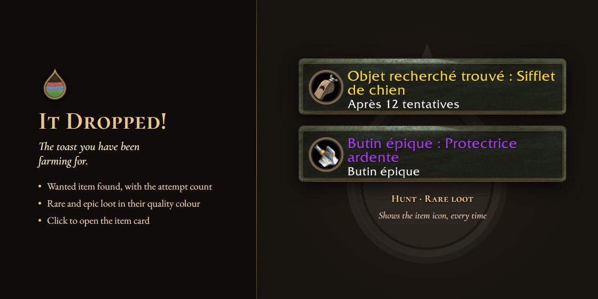

- First blood (first wanted item found) and Persistent (found after more than 50 attempts) achievements.

`/drop hunt` · Data is read live from the **Dungeon Journal** addon (optional, nothing bundled). Thanks to Exehn for the data and access to favourites.

## Every skill. Every +1.

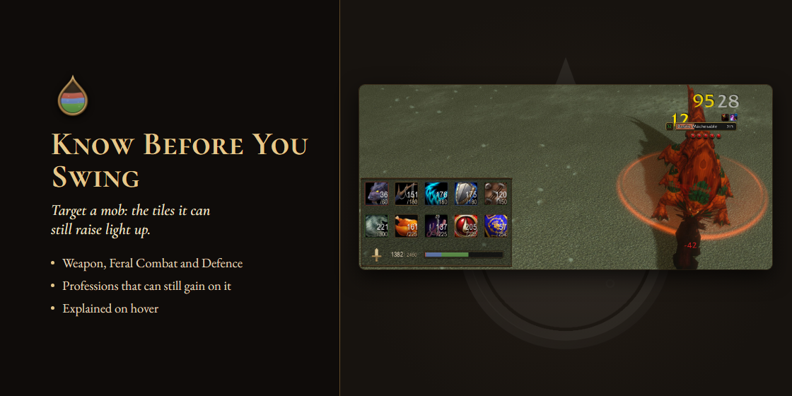

**1. You target a mob or a player.** The tiles that will rank up light up: the weapon in your hand, Feral Combat, Defence, a profession that can still gain on this target.

**2. You hit, you skin, you cook.** A coloured +1 flies from the toast to its tile and lands with a veil of the same colour: red for XP, blue for weapons and Defence, green for professions.

**3. You hover a tile or a creature.** The tooltip shows the rank, the cap, what is still to learn, and the linked professions.

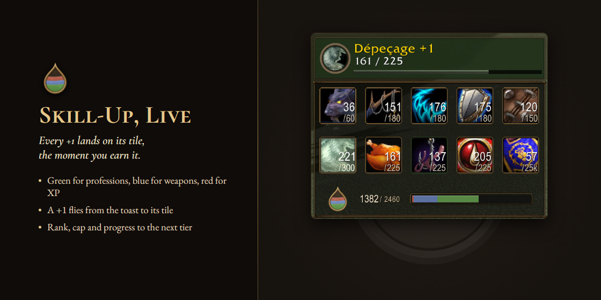

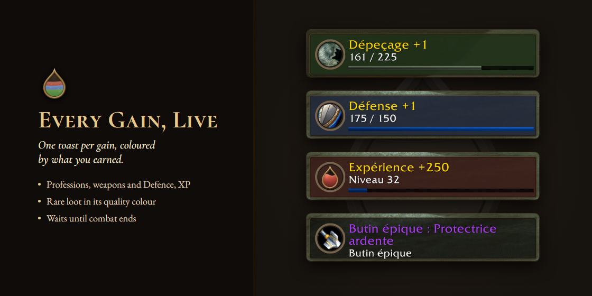

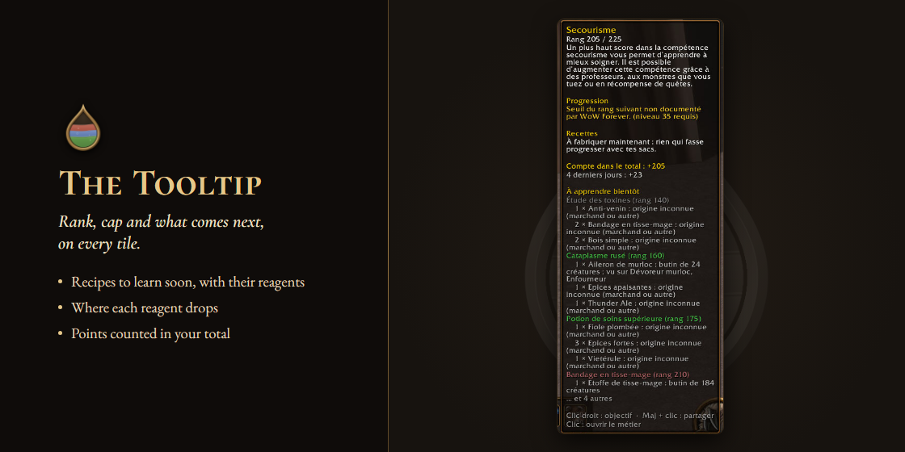

## Progression window

Left-click the droplet, or type `/drop progression`.

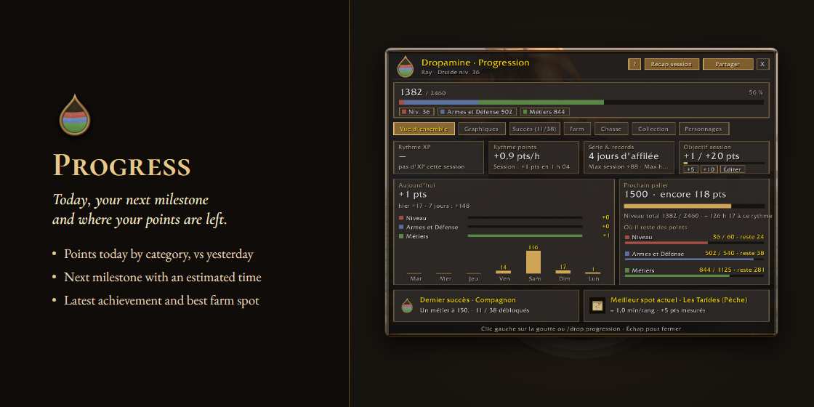

- **Overview:** a "Today" card (points by category, vs yesterday, last 7 days), your next total milestone with an estimated time at your current pace, and where your remaining points are.
- **Charts, weekly recap, farm spots and efficiency.**
- **Characters:** every character on the account, with class icon, total points, and their best professions and weapon skills.
- **Achievements:** streaks, active-time runs (30 min and 1 h without a break), exploration, collection, total milestones at 500 / 1000 / 1500 / 2000 / 2250. They stay reachable at any level and with any profession choice.
- **Total milestones:** a big gold animation, a cheer, and fireworks at the maximum.
- **Session recap:** this session against your previous one and your 7-day and 30-day averages.

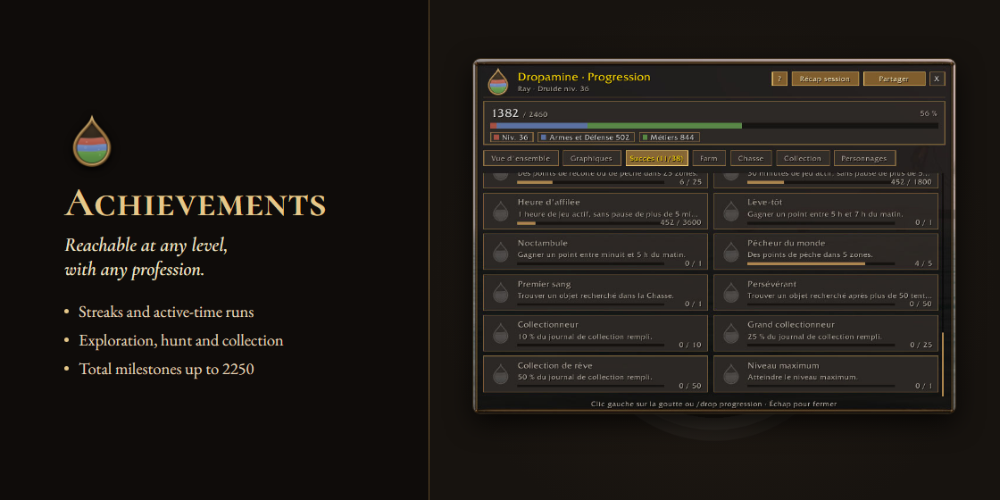

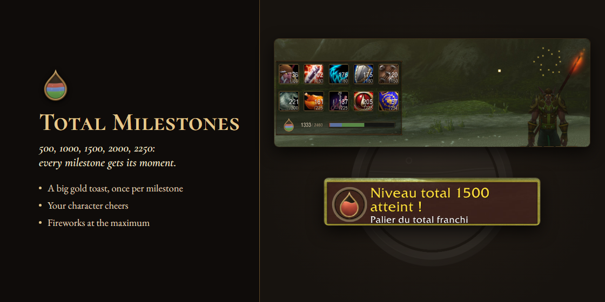

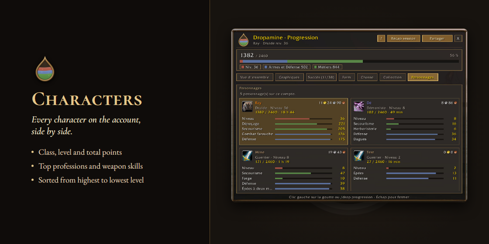

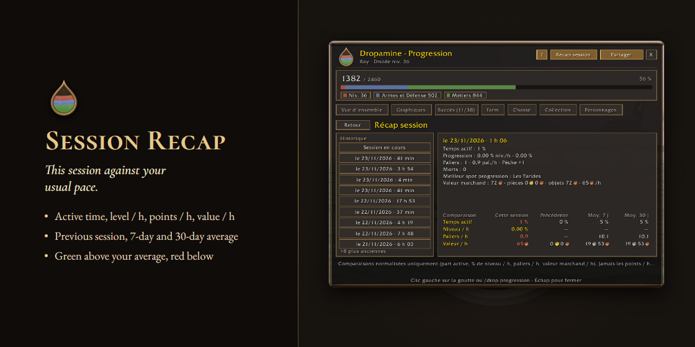

## Themes

`/drop theme light|flare2|flare|classic`

| Theme | What you get |
| --- | --- |
| **Léger** (default on new installs) | Just the tiles: no frame, no background. |
| **FlareUI (New)** | The FlareUI chat frame: a thick border and the knotted line along the top and bottom. Border texture from FlareUI (MIT). |
| **FlareUI (Old School)** | Dark fill, rounded bronze border. |
| **Classic** | In-game Blizzard textures. Nothing is copied into the addon. |

## First launch

A short guided tour shows each feature, lets you try it and switch it off. `/drop setup` replays it. `/drop about` shows the version and links.

## Commands

`/drop` shows or hides the panel. `/drop help` lists the main commands.

- `/drop progression` · `/drop collection` · `/drop hunt` — the Progression window, the Collection log, the hunt
- `/drop records` · `/drop tiers` · `/drop summary` — records, next milestone, your total on one line to paste
- `/drop options` · `/drop setup` · `/drop about`
- `/drop theme light|flare2|flare|classic` · `/drop columns 2|3|5|10` · `/drop lock`
- `/drop weapons` — weapons and Defense to level, with the monster levels that give points
- `/drop check` · `/drop debug` · `/drop perf` — health check and diagnostics

## Performance

Everything runs on game events. Nothing runs while idle, heavy scans wait until combat ends, and calm mode quiets the panel in dungeons and raids. `/drop perf` and `/drop check` show what it costs.

## FAQ

**Which game is this for?** WoW Forever only. It is not tested on official clients.

**Do I need Dungeon Journal?** No. The skills grid, toasts and the Progression window work without it. Dungeon Journal adds the boss loot tables to the Collection log and the hunt, and your favourites.

**Does it replace the native Skills tab?** No. Dropamine draws its own window.

**Are there sounds?** All off by default. `/drop sons` is the master switch.

## Install

Unzip into `World of Warcraft\_forever_\Interface\AddOns\`, so you have `AddOns\Dropamine\Dropamine.toc`.

Author: **Raykuilu**. License: **MIT**. Source: [github.com/Raykuilu/Dropamine](https://github.com/Raykuilu/Dropamine).

Skill tracking and collection log inspired by Old School RuneScape (unaffiliated, no Jagex assets). Visual inspiration from FlareUI by Malkkav. Dungeon Journal data and favourites access: thanks to Exehn. World of Warcraft and Blizzard textures referenced by path are © Blizzard Entertainment.

---

## Français

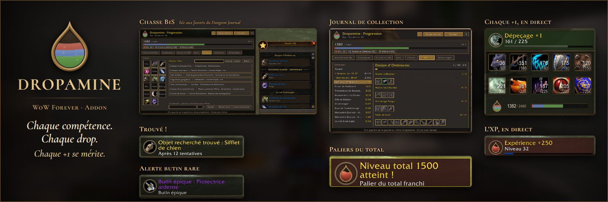

&nbsp;

**Dropamine 3.8** garde toutes tes compétences à l'écran, fête chaque +1 comme dans Old School RuneScape, et suit maintenant l'équipement que tu farmes : un **journal de collection** pour chaque donjon et raid, et une **chasse BiS** qui lit tes **favoris du Dungeon Journal**.

Pour **WoW Forever** uniquement (`Interface: 16001`). L'onglet Compétences natif n'est jamais caché, déplacé ni réécrit. FlareUI n'est pas nécessaire.

## Nouveau en 3.8 : le journal de collection

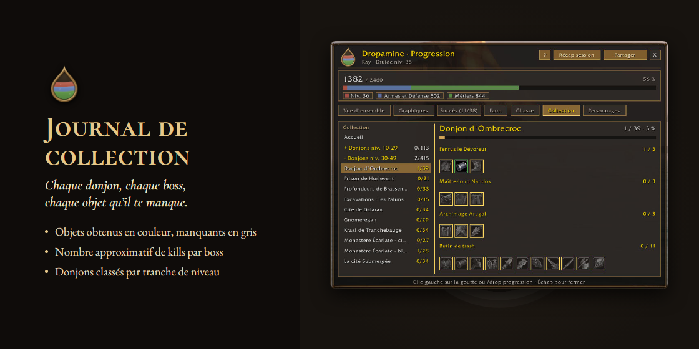

Ton collection log façon Old School RuneScape, pour les donjons et raids de WoW Forever.

- **Chaque donjon et raid**, classés par tranche de niveau. Chaque boss affiche ses objets avec leur icône : en couleur ceux que tu as, en gris ceux qui manquent.
- **Nombre approximatif de kills par boss** (≈N kills), compté à partir du butin de ses objets suivis.
- **Une page d'accueil** s'ouvre en premier : progression globale, donjons complets, kills de boss, objets, une barre par catégorie (un clic l'ouvre) et les donjons où tu es le plus avancé.

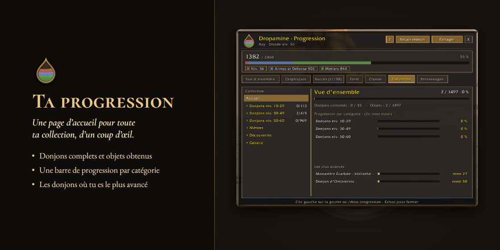

- **Les métiers aussi :** recettes connues sur le total, pour chaque métier appris. Pour la Cuisine et le Secourisme, les recettes manquantes sont listées par rang requis et par origine.
- **Découvertes :** le bestiaire et les créatures dépeçables rencontrées, par tranche de 10 niveaux, avec ta tranche mise en avant.
- Les catégories se plient et se déplient, et chacune affiche son propre X / Y. Les noms d'objets, de donjons et de boss suivent la langue du jeu.

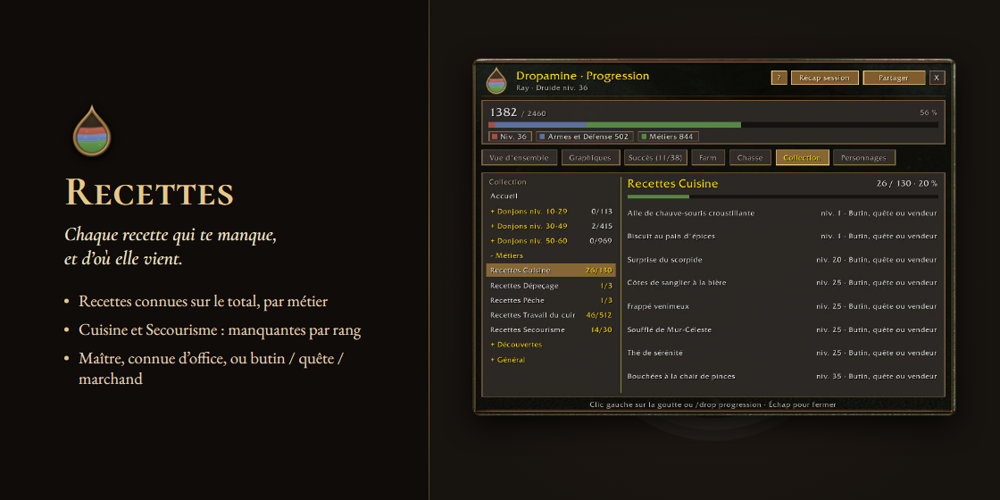

`/drop collection` · Succès de collection : Collectionneur (10 %), Grand collectionneur (25 %), Collection de rêve (50 %).

## Nouveau en 3.8 : la chasse BiS, liée aux favoris du Dungeon Journal

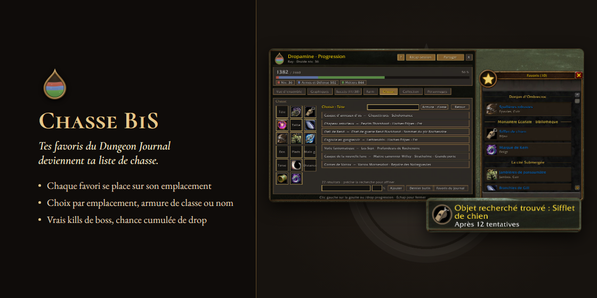

Choisis l'objet que tu veux, puis va le chercher.

- **Tes favoris du Dungeon Journal deviennent ta liste de chasse.** Chaque objet mis en favori se place tout seul sur son emplacement d'équipement. Si plusieurs objets visent le même emplacement, la grille affiche le meilleur.
- **Une grille d'équipement.** Clique sur un emplacement pour choisir l'objet dans les données du Dungeon Journal (filtre sur l'armure de ta classe, recherche par nom). Tu peux aussi ajouter un objet par nom, lien ou ID, ou depuis ton dernier butin.
- **De vrais essais.** Les kills de boss sont détectés à partir des messages de butin : un essai est un vrai kill, pas une fenêtre de butin ouverte. Pour chaque objet : le nombre d'essais et la chance cumulée qu'il soit déjà tombé.
- **Trouvé !** Un toast avec l'icône de l'objet. Un clic ouvre la fiche de l'objet, avec la comparaison d'équipement.
- **Alerte butin rare :** un toast dans la couleur de qualité de l'objet pour chaque butin épique (ou rare, si tu le choisis).

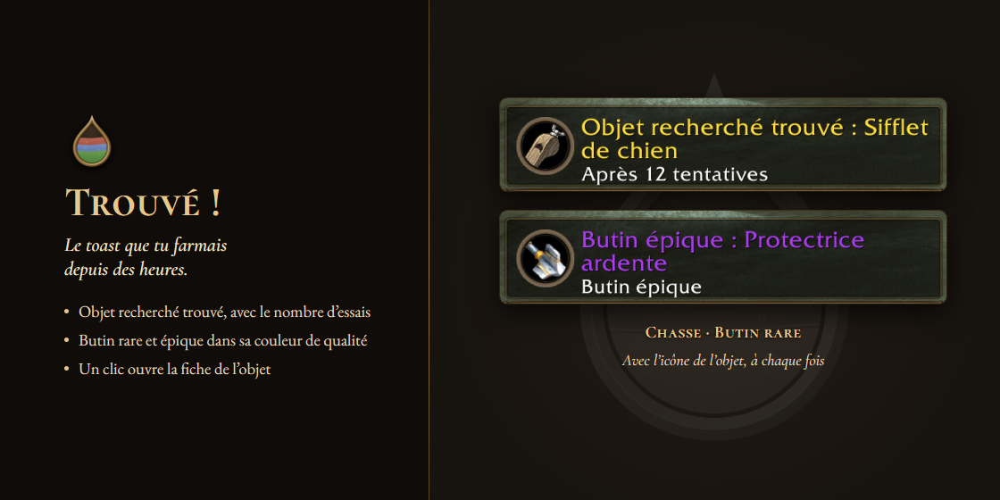

- Succès Premier sang (premier objet recherché trouvé) et Persévérant (trouvé après plus de 50 essais).

`/drop chasse` · Les données sont lues en direct dans l'addon **Dungeon Journal** (facultatif, rien n'est embarqué). Merci à Exehn pour les données et l'accès aux favoris.

## Chaque compétence. Chaque +1.

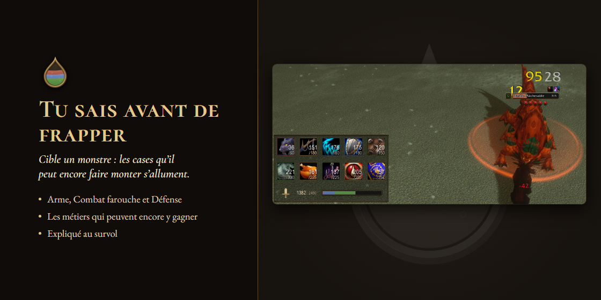

**1. Tu cibles un monstre ou un joueur.** Les cases qui vont monter s'allument : l'arme en main, Combat farouche, Défense, un métier qui peut encore gagner sur cette cible.

**2. Tu frappes, tu dépèces, tu cuisines.** Un +1 coloré vole du toast jusqu'à sa case et s'y pose avec un voile de la même couleur : rouge pour l'XP, bleu pour les armes et la Défense, vert pour les métiers.

**3. Tu survoles une case ou une créature.** L'infobulle donne le rang, le plafond, ce qui reste à apprendre et les métiers liés.

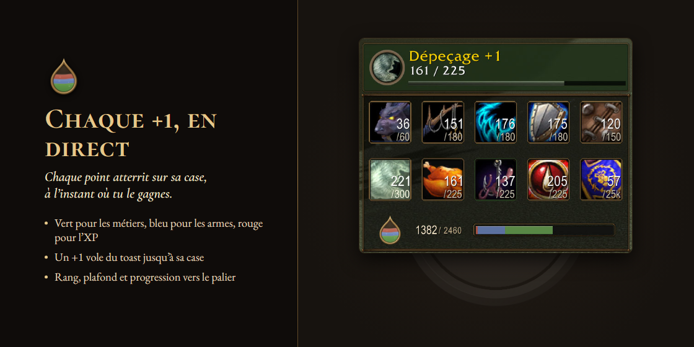

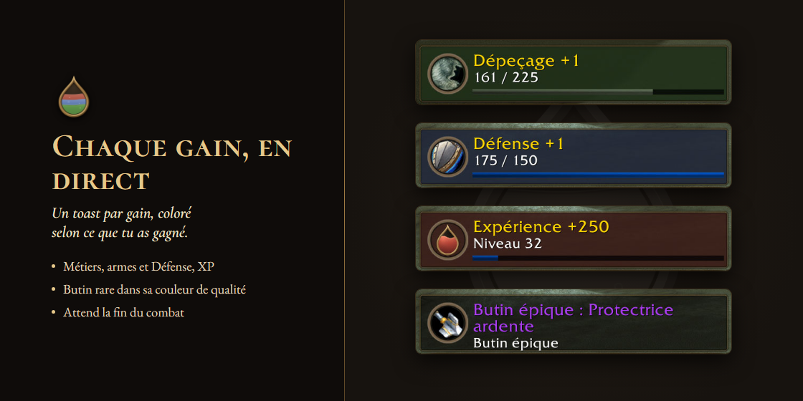

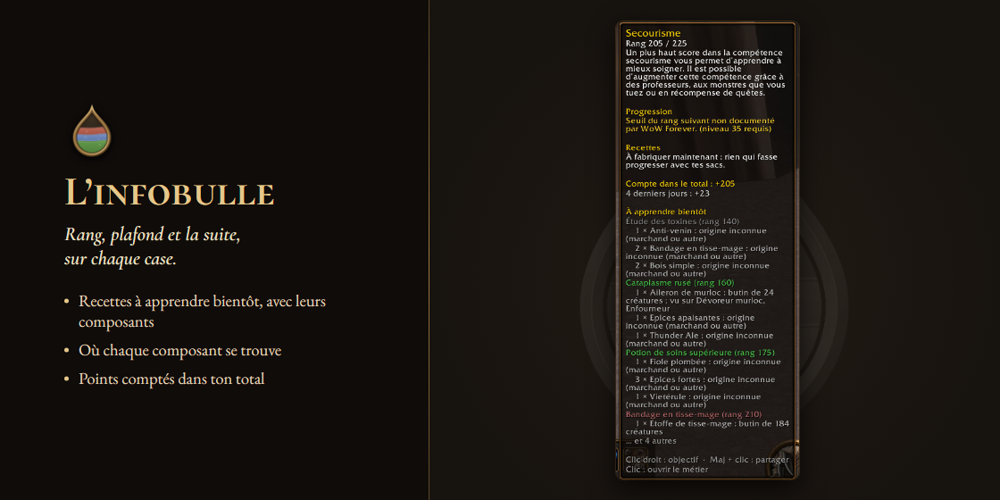

## Fenêtre Progression

Clic gauche sur la goutte, ou `/drop progression`.

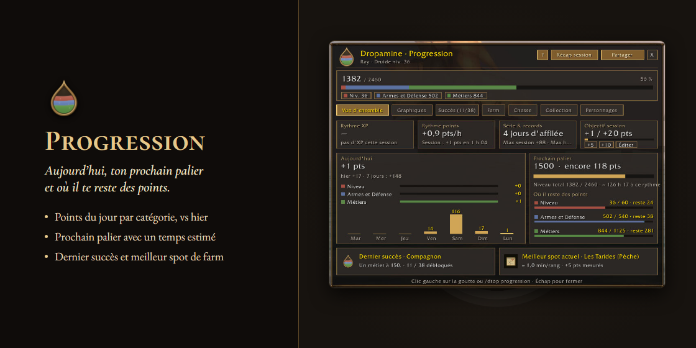

- **Vue d'ensemble :** une carte « Aujourd'hui » (points par catégorie, comparés à hier et aux 7 derniers jours), ton prochain palier avec un temps estimé à ton rythme actuel, et où il te reste des points.
- **Graphiques, récap hebdo, spots de farm et efficacité.**
- **Personnages :** tous les personnages du compte, avec l'icône de classe, le total de points, et leurs meilleurs métiers et compétences d'arme.
- **Succès :** séries, sessions actives (30 min et 1 h sans pause), exploration, collection, paliers du total à 500 / 1000 / 1500 / 2000 / 2250. Ils restent atteignables à tout niveau, quels que soient tes métiers.
- **Paliers du total :** une grande animation dorée, ton personnage qui applaudit, et un feu d'artifice au maximum.
- **Récap de session :** cette session comparée à la précédente et à tes moyennes sur 7 et 30 jours.

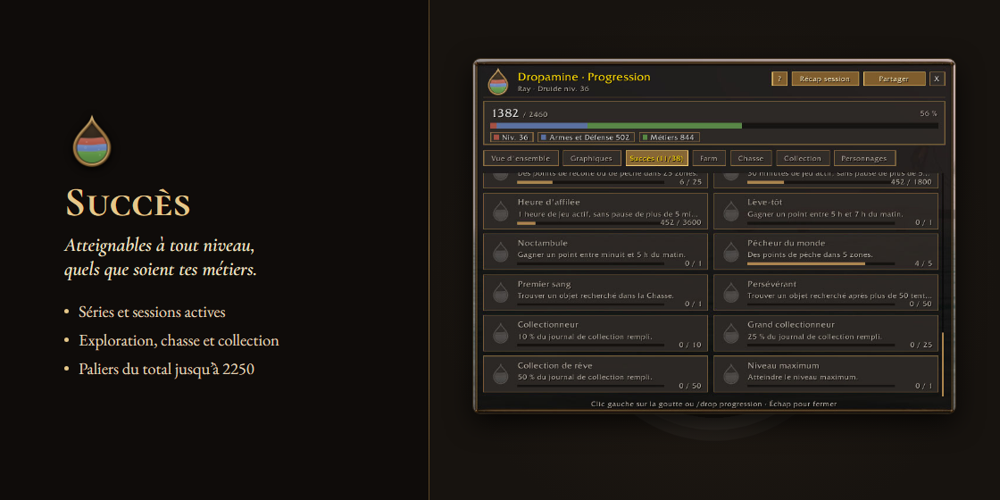

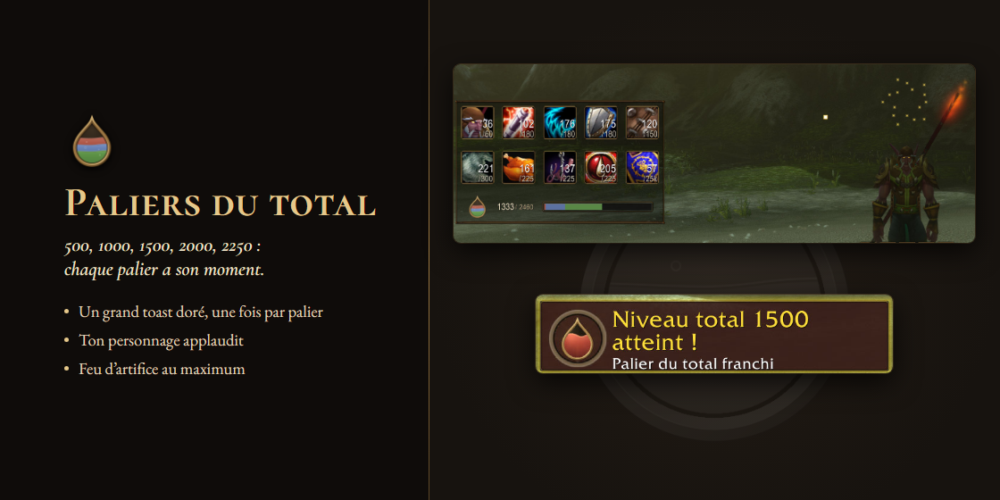

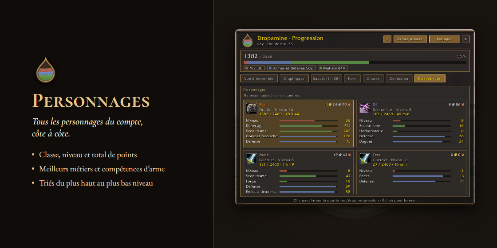

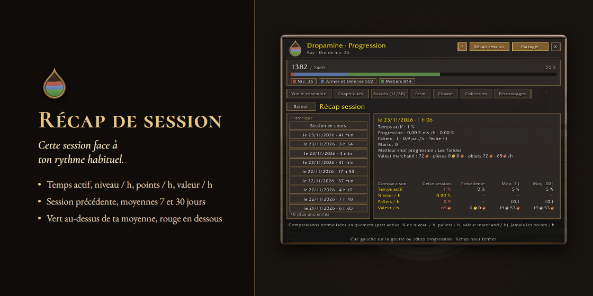

## Thèmes

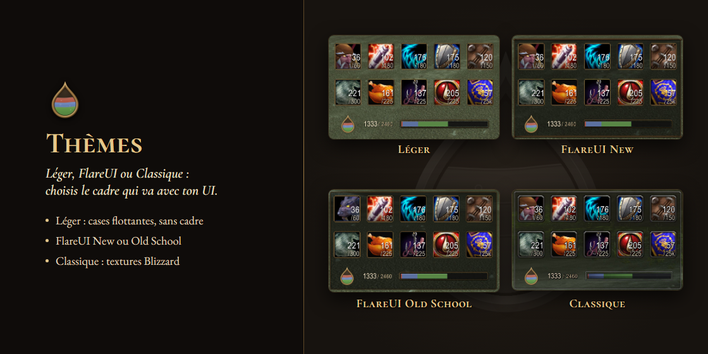

`/drop theme leger|flare2|flare|classic`

| Thème | Ce que tu obtiens |
| --- | --- |
| **Léger** (par défaut sur une nouvelle installation) | Juste les cases : ni cadre, ni fond. |
| **FlareUI (New)** | Le cadre du chat FlareUI : bordure épaisse et ligne nouée en haut et en bas. Texture de bordure issue de FlareUI (MIT). |
| **FlareUI (Old School)** | Fond sombre, bordure bronze arrondie. |
| **Classique** | Les textures Blizzard du jeu. Rien n'est copié dans l'addon. |

## Premier lancement

Une courte visite guidée présente chaque fonction, te laisse l'essayer et la couper. `/drop setup` la relance. `/drop about` affiche la version et les liens.

## Commandes

`/drop` affiche ou cache le panneau. `/drop help` liste les commandes principales.

- `/drop progression` · `/drop collection` · `/drop chasse` : la fenêtre Progression, le journal de collection, la chasse
- `/drop records` · `/drop paliers` · `/drop resume` : records, prochain palier, ton total sur une ligne à coller
- `/drop options` · `/drop setup` · `/drop about`
- `/drop theme leger|flare2|flare|classic` · `/drop colonnes 2|3|5|10` · `/drop verrou`
- `/drop check` · `/drop debug` · `/drop perf` : bilan de santé et diagnostic

## Performances

Tout fonctionne sur les événements du jeu. Rien ne tourne au repos, les analyses lourdes attendent la fin du combat, et le mode calme apaise le panneau en donjon et en raid. `/drop perf` et `/drop check` montrent ce que ça coûte.

## FAQ

**Pour quel jeu ?** WoW Forever uniquement. L'addon n'est pas testé sur les clients officiels.

**Faut-il Dungeon Journal ?** Non. La grille, les toasts et la fenêtre Progression fonctionnent sans. Dungeon Journal ajoute les tables de butin des boss au journal de collection et à la chasse, ainsi que tes favoris.

**Ça remplace l'onglet Compétences natif ?** Non. Dropamine dessine sa propre fenêtre.

**Il y a des sons ?** Tous coupés par défaut. `/drop sons` est l'interrupteur général.

## Installation

Décompresse l'archive dans `World of Warcraft\_forever_\Interface\AddOns\`, pour obtenir `AddOns\Dropamine\Dropamine.toc`.

Auteur : **Raykuilu**. Licence : **MIT**. Source : [github.com/Raykuilu/Dropamine](https://github.com/Raykuilu/Dropamine).

Suivi des compétences et journal de collection inspirés d'Old School RuneScape (projet non affilié, aucun asset Jagex). Inspiration visuelle : FlareUI de Malkkav. Données et favoris du Dungeon Journal : merci à Exehn. World of Warcraft et les textures Blizzard référencées par chemin sont © Blizzard Entertainment.
