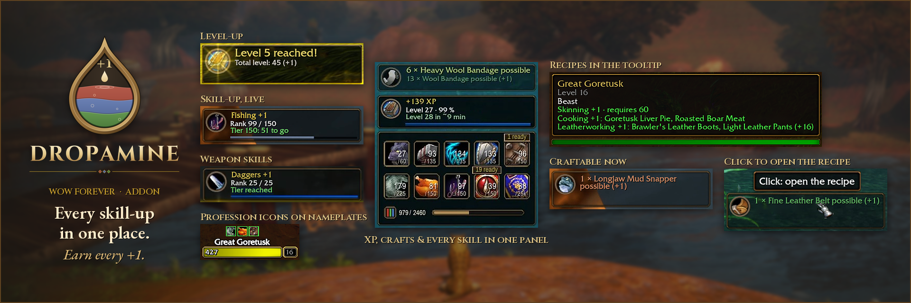

**Earn every +1.** Every skill-up in one place. Now at **v3.6.3**, with a Progress window and a Rested XP animation on the Level tile.

Old School RuneScape ironman energy, on WoW Forever. No leaderboards, no shortcuts, nobody to impress: just you, the grind, and every point you earned yourself. Dropamine puts your level, weapon skills, Defense and professions in one small panel, and makes every +1 land.

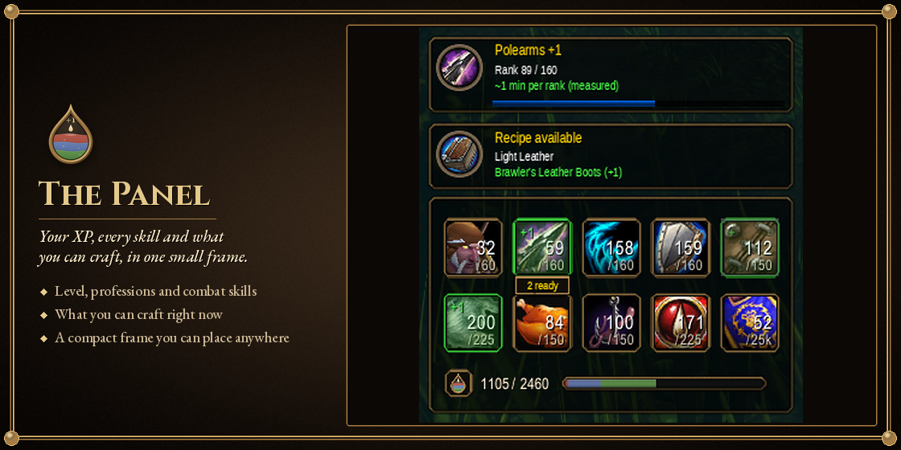

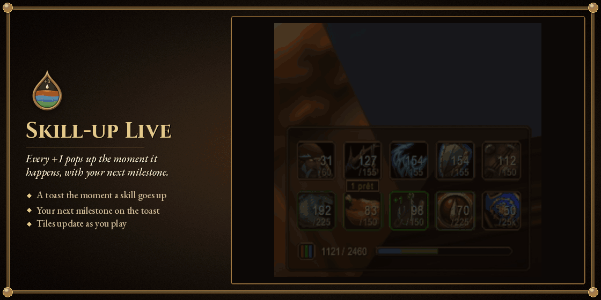

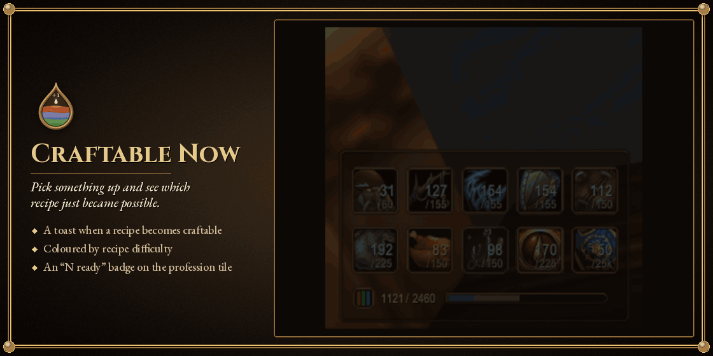

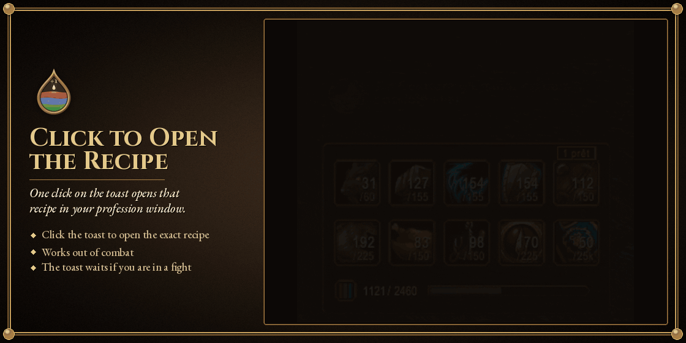

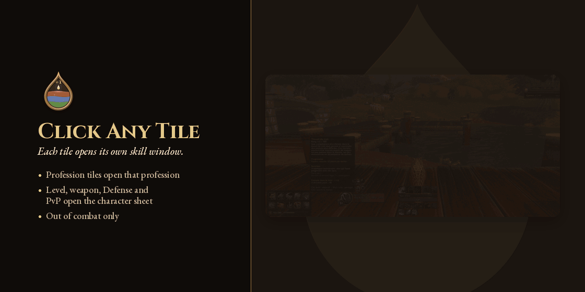

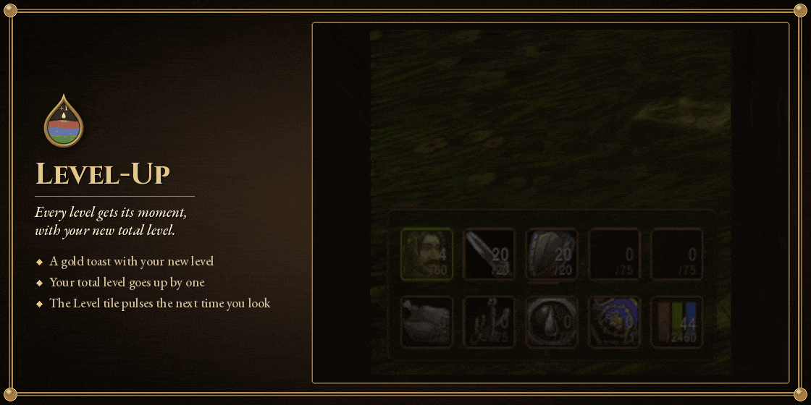

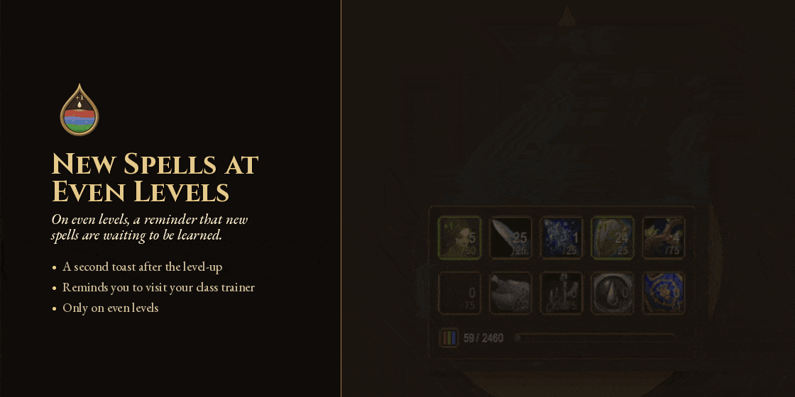

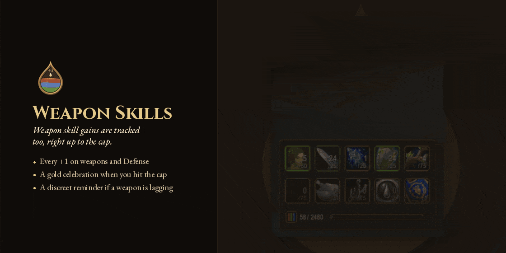

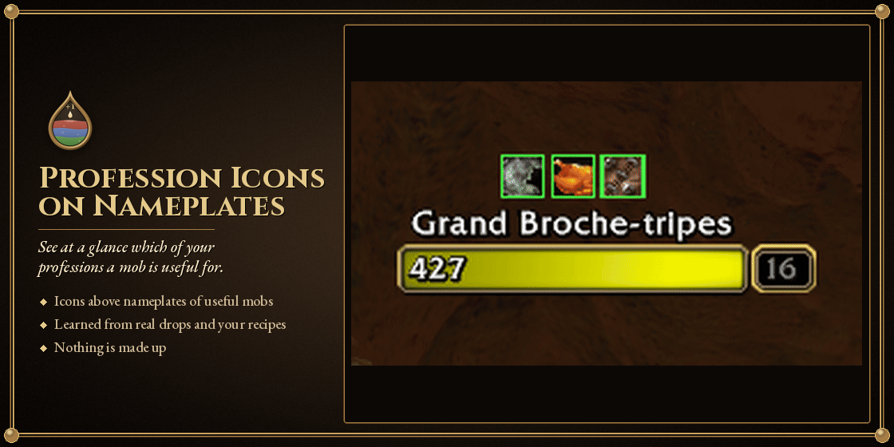

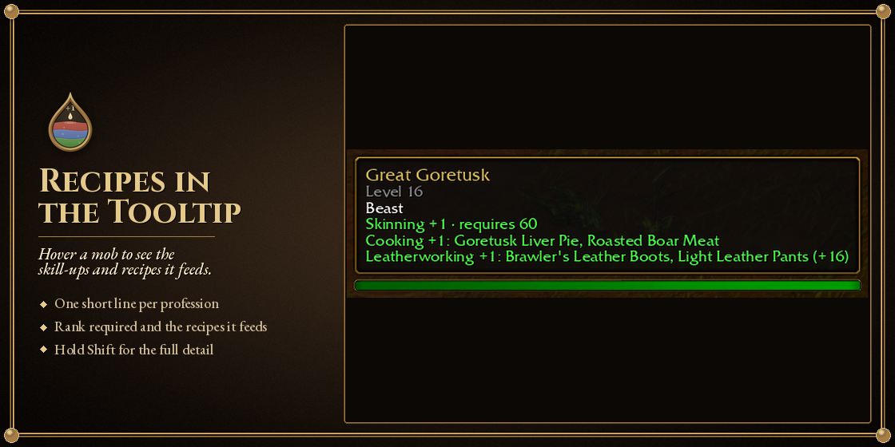

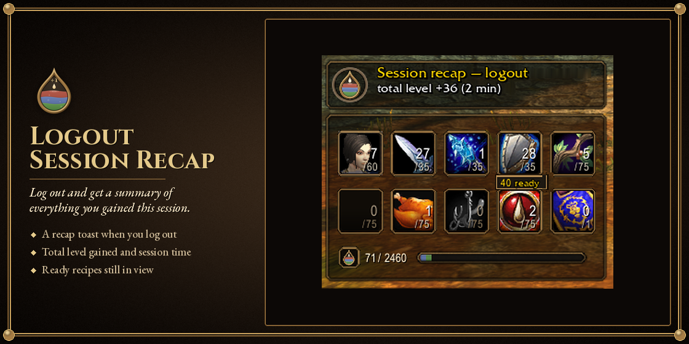

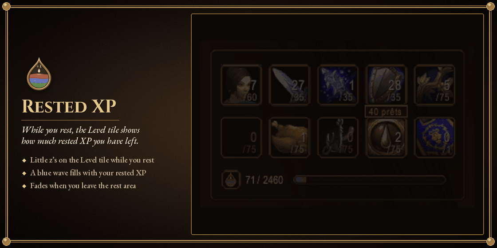

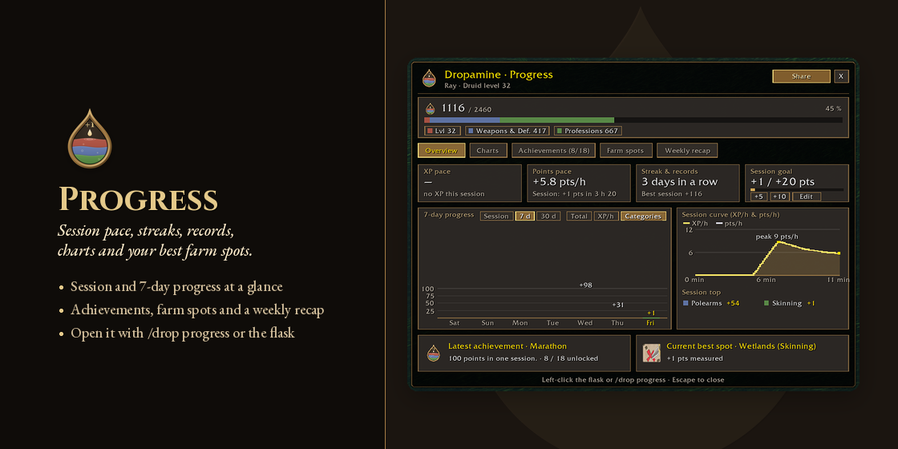

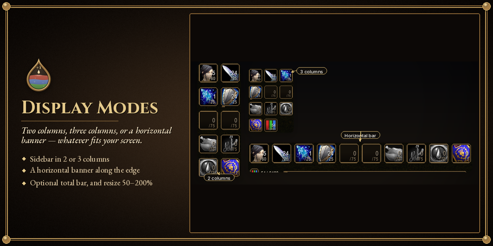

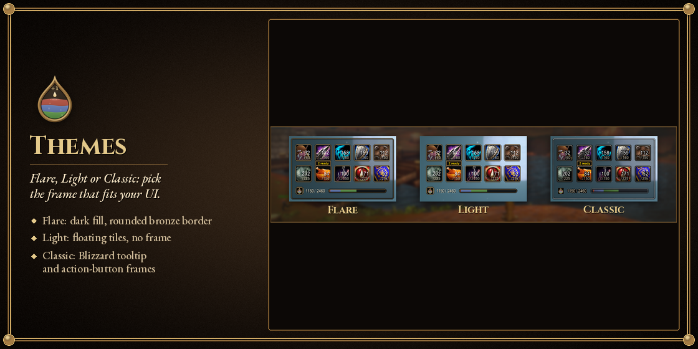

## Slash commands

Everything goes through `/drop` (or `/dropamine`):

| Command | What it does |
| --- | --- |
| `/drop` | Open / close the panel (the minimap button does too) |
| `/drop options` | Settings panel |
| `/drop edit` | Move, resize and quick settings |
| `/drop help` | Short command list (`/drop help tout` for all of them) |
| `/drop reset` | Reset the panel position |
| `/drop lang` | Interface language: `auto` (your game language), `en` or `fr` |
| `/drop debug` | Copyable diagnostics report |

## Compatibility

- Made for **WoW Forever**.
- Addon available in **English and French** (follows your game language, or set it with `/drop lang`).
- Clicks and recipe reading happen **out of combat only**.
- The panel opens reliably even when FlareUI or AtlasLoot move or hide the Character frame.
- 100 % free, MIT licence.

## FAQ

**The "N ready" badge and recipe lines stay empty?** Open each profession window once: Dropamine reads your known recipes from there.

**No icons on nameplates yet?** Dropamine learns what creatures drop as you loot them. Kill and loot a few first.

**Any sounds?** All off by default. Turn them on in `/drop options` if you want them.
